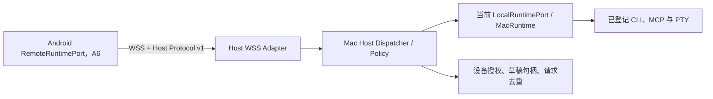

# A5：macOS Host 模块与配对协议设计

> 设计基线 v0.1，2026-11-13。本文记录 A5 的接口、协议和安全要求及后续实现进度；其中尚未实现的部分仍以 [Android 适配计划](android-adaptation-plan.md) 的阶段门槛为准。

## 目标与当前代码事实

Host 是同一 Flutter App 中由用户主动开启的 macOS 远程执行入口。它复用当前 App 已打开的 `MacRuntime`、Keychain、MCP 会话、CLI 和 PTY；不创建另一个运行时副本或后台 `launchd` 进程。App 退出或用户关闭 Host 后，手机显示 Host 离线。



现有实现给协议带来几项必须处理的约束：

- `LocalRuntimePort.createLive()` 创建一个 `MacRuntime`；Host 必须注入并复用此实例，不能自行重新打开同一份连接存储。
- `RuntimePort.invoke()` 接受调用方传入的 `permissionGranted`。Mac Host 不能把网络请求里的布尔值直接当作授权；先按配对设备、连接和 `PermissionLevel` 做 Host 本地策略检查，再决定是否可委托运行。
- `ConnectionSetupDraft.values` 只应存在于内存；`ConnectionSpec.toJson()` 不包含 `authToken`。Host 的传输 DTO 必须显式区分公开配置和凭证字段，日志、活动和错误中不得记录凭证值。
- `MacRuntime.testConnectionSetup()` 会执行草稿中的程序路径。Host 不得接受 Android 传来的任意绝对路径；新 CLI 必须先由 Mac 用户选择/登记，再用 Host 签发的短期 `executableRef` 表示。
- `CliCommand` 只含连接 ID 和参数列表；PTY 的可执行程序由已保存连接决定。协议不提供 `shell(command)`、`process.start(path, args)` 或任意工作目录 RPC。
- `watchRun()` 已提供带 `RunId` 和递增 sequence 的事件；`watchTerminal()` 目前只提供文本流，Host 适配器需补充可恢复的终端事件序号。

## 模块接口与接缝

新增深模块 `MacHostModule` 承担 Host 生命周期、身份、授权、草稿/运行归属和协议分发。App 只知道 Host 控制接口，不管理 socket、签名、重试、游标或 MacRuntime 的内部 ID：

```dart
abstract interface class HostControlPort {
  HostStatus get status;
  Stream<HostStatus> watchStatus();
  Future<void> start();
  Future<void> stop();
}
```

A5.1 先落地状态查询与 `start()` / `stop()`；邀请、设备批准和撤销操作会在 A5.4 配对身份模型确定后加入此接口。

实现使用两个接缝：

1. **运行端接缝：**注入 `RuntimePort`、`ConnectionSetupPort`、`ConnectionAccountPort`，生产接 `LocalRuntimePort`，测试使用 fake。Mac Host 通过统一 dispatcher 调用这些已存在的契约；不在 socket handler 中直接创建进程或访问路径。
2. **传输接缝：**注入 Host transport adapter，生产使用 `dart:io` secure WebSocket，测试使用内存消息适配器。Dispatcher 在传输之外执行设备授权、输入限制、敏感字段处理、请求去重及目标运行时调用。

Host 不实现第二套连接、CLI、MCP 或账号运行逻辑。网络层只接受本文逐项列出的已登记操作；未识别方法返回 `methodNotFound`。

## 传输与版本

- 使用 **WSS（TLS 1.2 或更高）+ JSON-RPC 2.0**。JSON-RPC 的 `id` 只用于请求/响应关联；Aggregate 的 `protocolVersion` 在 `host.hello` 中协商，当前主版本为 `1`。不同主版本不兼容时返回 `unsupportedVersion`，不能忽略未知字段后执行有副作用的请求。
- v1 客户端请求必须包含非空字符串 `id`；禁用 batch 和 client notifications。Host 可以用 JSON-RPC notification 向已认证连接推送事件。
- 文本帧用 JSON；批量 RPC 禁用，以便明确执行顺序、权限和失败点。媒体/文件不放进任意 base64 JSON；如 A5.2 实作需要传文件，使用版本化的分块数据帧和 Host 发放的一次性传输句柄。
- 每个改变 Mac 状态或可能产生外部副作用的操作都带 `operationId`。Host 将 `(deviceId, operationId, payloadHash, state)` 先记入 Mac 本地的权限受限操作账本再执行。`payloadHash` 是方法名与参数（排除 request ID、签名、时间戳和 `operationId`）的规范 JSON SHA-256。同一 ID、同一参数重发只返回已记录状态；同一 ID 不同参数返回 `idempotencyConflict`。`started` 后 Host 意外退出则保持 `outcomeUnknown`，不得把重试当成新操作执行。
- `RunEvent.sequence` 与 `TerminalEvent.sequence` 用作恢复游标。重连后客户端携带最后确认的 sequence；Host 只重放缺失事件。缓冲区已淘汰时返回 `cursorExpired`，手机需重新读取运行状态，不能自动重放调用。
- MCP 调用或配置操作断线时，客户端先查询 `operationId`/`RunId`。结果未知的调用不自动重试。终端文本、取消信号和账号登录命令不重放。

认证帧在内层放标准 JSON-RPC 文本；设备使用 Android Keystore 中的 P-256 私钥签名，算法固定为 ECDSA/SHA-256，签名以 DER 编码后 base64。签名输入按 UTF-8 精确构造为 `aggregate-host-v1\n{hostId}\n{deviceId}\n{timestamp}\n{nonce}\n{payloadSha256Hex}`；ID 和 nonce 字符集受限、不得包含换行。`payloadSha256Hex` 是接收的内层 JSON-RPC UTF-8 字节的 SHA-256，不由两端解析后重序列化再签名。示意：

```json
{"protocolVersion":1,"hostId":"host-…","deviceId":"device-…","timestamp":1794528000,"nonce":"…","payload":"{\"jsonrpc\":\"2.0\",\"id\":\"req-…\",\"method\":\"run.invoke\",\"params\":{\"operationId\":\"op-…\",\"capability\":{…},\"arguments\":{}}}","signature":"base64…"}
{"jsonrpc":"2.0","id":"req-…","result":{"run":{"id":{"value":"…"}}}}
{"jsonrpc":"2.0","method":"run.event","params":{"subscriptionId":"sub-…","sequence":3,"event":{"runId":{"value":"…"},"sequence":3,"state":"running","occurredAt":"…","blocks":[]}}}
```

第一帧是已签名的客户端请求，第二、三帧是通过固定 TLS 通道返回的 Host 响应和事件。Host 先验证签名，再解析 `payload`，随后拒绝过期时间戳（±60 秒）、5 分钟内重放的 nonce、未知设备或缺少 grant 的操作。TLS pin 使用扫描配对二维码时记录的 Host 叶证书 DER SHA-256。设备在 TLS pin 验证后还需签署 Host 新发的随机 challenge，认证完成前不返回连接目录、能力或路径信息。

## 允许的方法与路径语义

首版只发布当前配对设备被授权的操作。所有操作都以 ID 引用已存在的 Host 对象；不能用手机发送路径来选择 Host 文件或程序。

| 方法组 | v1 操作 | 主机约束 |
| --- | --- | --- |
| Host 元数据 | `host.hello`、`host.status` | 返回稳定 `hostId`、协议主版本、Host 名称和在线能力；不返回密钥或 Home 路径。 |
| 连接 | `connection.list`、`connection.refresh`、`connection.remove`、`connection.move` | 只操作 Host 连接；ID 在 Android 侧加 Host 来源前缀，Mac 持久化原始 ID。删除必须清理 Mac 自有凭证/profile。 |
| 向导 | `setup.adapters`、`setup.detectExecutable`、`setup.resolveExecutable`、`setup.test`、`setup.save`、`setup.discard` | 返回 Host 适配器目录；草稿句柄由 Host 签发并绑定设备身份。CLI 自动检测或按 basename 查找都只返回短期 opaque `executableRef` 和可展示位置，不向 Android 返回 Mac 路径。适配器必须在 Host 白名单内。 |
| 能力与结果 | `capability.search`、`run.invoke`、`run.subscribe`、`run.cancel`、`run.listRecent`、`activity.clear`、`resource.read`、`prompt.get` | 能力/运行必须属于已授权连接；`permissionGranted` 仅在 Host 自身权限策略允许后传给 `RuntimePort`。 |
| 动作清单 | `manifest.get`、`manifest.save`、`manifest.readContent`、`manifest.exportContent` | 连接必须是已授权 CLI；文件内容经显式内容传输或一次性 Host 文件句柄，绝不把 Mac 路径当 Android 本地路径。 |
| 账号 | `account.read`、`account.beginLogin`、`account.waitLogin`、`account.logout` | `account.read` 以 `{snapshot: ...}` 表达受支持状态或 `null`；仅暴露 Mac 已实现并验证的账号适配器；登录的 PTY/配置/profile 留在 Mac。登出需要对应设备授权和用户确认。 |
| 终端 | `terminal.open`、`terminal.subscribe`、`terminal.write`、`terminal.resize`、`terminal.interrupt`、`terminal.close` | 只对登记 CLI 连接开放；`terminal.open.arguments` 是最多 256 项、单项最多 4096 字符的参数向量，不接受 shell 字符串；单独 `terminal` grant；宿主执行程序仍由连接决定。限制帧、并发和输出缓存。 |

不远程暴露 Mac 全局 UI 偏好、任意 `previewLocalFile(path)`、`revealLocalFile(path)`、本机原始文件路径操作、未经批准的程序路径、任意环境变量、任意 shell 字符串或动态代码加载。若未来要增加方法，先新增版本化 DTO、授权规则、输出上限和恢复语义，再纳入允许列表。

### 向导密文与程序引用

- 公开字段通过版本化 `SetupDraftPayload` 传送；`authToken`、Private Key 等由独立 `secretValues` 段承载，只通过已经配对的 WSS 连接传输。调试日志只记录 request ID、adapter ID、字段名、字节数和结果状态，不记录值或原始 body。
- Mac Host 生成随机 `draftHandle`，并映射到 MacRuntime 的真实 `draftId`；映射键包含 `deviceId`，默认 TTL 10 分钟。保存/丢弃成功、输入变更、设备断线超时、Host 停止和撤销配对时失效；必要时调用 `discardConnectionSetup` 删除临时 profile。
- `executableRef` 和 `manifestRef` 是 Host 随机签发的 opaque 引用，绑定设备/草稿并短期有效。路径由 Mac 文件选择/登记流程确认后保留在 Mac；Android 只能显示明确标注的 Host 路径，不能传回该字符串执行文件操作。

## 配对、认证与授权

1. Host 只有在 Mac 用户主动开启时才创建 WSS listener。它生成稳定随机 `hostId`，TLS server key/certificate 由 macOS Keychain 保护；Listener 运行时才将必要密钥材料载入进程内存，停止时清理。默认不随登录后台启动。
2. Mac 展示一次性配对 QR 和待批准设备。QR 中包含 Host ID、发现信息、TLS 证书 SHA-256 指纹及 5 分钟有效、单次可用的邀请 nonce；不含长期设备凭证。Bonjour 仅用于发现在线地址，不代表信任。
3. Android 首次配对时在 Android Keystore 生成 P-256 请求签名密钥，发送公钥、由公钥摘要派生的稳定 `deviceId` 和邀请 nonce。Mac 显示设备名称、平台及短确认码，由 Mac 用户批准后，按连接和权限等级发放最小 grant；默认只给读取，外部写入、终端、账号管理和连接管理需额外授权。
4. Android 对每个 RPC 请求签署规范化的 method、request ID、operation ID、时间戳、nonce 和 body SHA-256。Host 验证设备公钥、时间窗、nonce 未重放、请求大小和 grant，再进入 dispatcher。TLS 的 Host 身份以扫描时记录的证书指纹固定；不能对任意证书返回接受。
5. Mac 的“已配对设备”设置可撤销设备；撤销立即终止其 WebSocket、清理该设备草稿/一次性引用并关闭它拥有的终端。Host 证书轮换必须通过 Mac 用户确认后让设备重新配对，不能静默改 pin。

配对仅代表身份可信，不代表设备自动拥有所有功能。Host 按 `(deviceId, connectionId, grant)` 检查每次调用；grant 包括读取、调用权限等级、连接设置/管理、账号、终端、活动清理和内容传输。设备端 UI 的确认不替代 Host 授权。现有 `PermissionLevel` 的 `read`、`localControl`、`externalWrite` 应保留，不把未知权限降级为允许。

## 生命周期、网络权限与资源限制

- 只有 A5.4 的配对/认证入口完成后，生产传输才允许绑定 TLS listener。A5.1 的 `PairingRequiredHostTransport` 固定拒绝启动，不含 socket 或 Bonjour 操作；不能以测试 transport 的启动成功代表 Host 已可联网。后续生产 `start()` 先装载密钥/授权、绑定 TLS listener、注册 Bonjour，全部成功后状态才变为 `running`；邀请生成另由 A5.4 控制，不能因单纯开启 Host 就发放配对凭据。部分启动失败需回滚 socket 和服务发现。`stop()` 先拒绝新请求，关闭 listener 和所有远程订阅，再清理 Host 自有草稿、PTY 和运行；停止与本机 UI 的 LocalRuntime 分离，不能调用全局 `MacRuntime.dispose()`。
- 由于 MacRuntime 是 App 内进程对象，App 退出后 Host 离线。远程运行在网络断开后只可继续等待/查询；App 退出后的外部结果标为未知，不自动重放。
- Bonjour 服务类型固定为 `_aggregate-host._tcp`。Mac app 的 `Info.plist` 需提供 `NSLocalNetworkUsageDescription` 和 `NSBonjourServices`； macOS 15 首次本地网络访问会触发系统授权。应使用正式签名的 App 进程发起网络操作，Host 未运行时不触发本地网络访问。
- WSS 使用随机端口；只绑定当前可路由的局域网接口，不能绑定公网接口或打开端口转发。发现/配对不发送凭证。Server 必须检查 TLS 版本、Host 证书 pin、请求签名和时间窗；明文 WS 一律拒绝。
- Host v1 实作前定出并测试帧大小、字段长度、每设备并发、超时和事件缓冲限额。上限至少不宽于 MacRuntime 的 3 个并发运行/终端和每条 1 MiB 输出缓冲；传输不可把一个连接的无界数据写入另一连接。
- 错误只返回稳定错误码、阶段、短脱敏说明；不返回 Dart stack、命令 stderr 中的秘密、Home 路径或 Keychain 错误详情。运行的 stdout/stderr 仍通过用户已授权的结果/终端流可见，不进入 Host 诊断日志。

## 阶段落地顺序

| 子阶段 | 交付 | 关闭条件 |
| --- | --- | --- |
| A5.1 | `HostControlPort`、复用 MacRuntime 的 `MacHostModule`、显式 start/stop 生命周期；默认关闭。生产 listener 在 A5.4 配对认证完成前保持禁用。 | 不能创建第二个 MacRuntime；服务停止不破坏本机连接；启动/停止序列化，启动失败会回滚。 |
| A5.2 | JSON-RPC v1 的 DTO/方法目录、错误、事件游标、operationId、规范化哈希和协议兼容规则。 | 协议测试覆盖拒绝未知方法/版本、重复字段与无效 schema、请求/响应帧限制、重复写操作冲突和进程重启后的结果未知。 |
| A5.3 | Host adapter allowlist、executableRef、设备绑定 draftHandle、凭证传输与 Mac 端授权。 | 不接受任意路径/命令；秘密不落日志、Activity 或持久草稿。 |
| A5.4 | Keychain/Android Keystore 设备身份、一次性配对、最小 grant、撤销/重连/轮换。 | 未批准设备无法执行；撤销立即断开并清理关联资源。 |
| A5.5 | 真机普通 CLI、TUI、stdio/HTTP MCP、网易云向导以及未授权/越权/重复请求样本。 | 手机能在标注 Mac 执行的位置完成允许流程，Host 失败不改成本地执行。 |

## 依据与限制

- [Apple TN3179：本地网络隐私](https://developer.apple.com/documentation/technotes/tn3179-understanding-local-network-privacy) 与 [NSLocalNetworkUsageDescription](https://developer.apple.com/documentation/BundleResources/Information-Property-List/NSLocalNetworkUsageDescription) 说明本地单播/Bonjour 操作、macOS 本地网络许可、用途说明及 Bonjour 服务列表。Apple 还建议用正式代码签名身份确保 macOS 能可靠识别负责程序。
- [Dart `HttpServer.bindSecure`](https://api.dart.dev/dart-io/HttpServer/bindSecure.html) 支持 HTTPS listener 与指定接口绑定；[Dart `WebSocketTransformer`](https://api.dart.dev/dart-io/WebSocketTransformer-class.html) 支持从 HTTP(S) 升级至双向 WebSocket；[`HttpClient.badCertificateCallback`](https://api.dart.dev/dart-io/HttpClient/badCertificateCallback.html) 允许客户端作证书判断，必须仅在与已配对 Host 指纹相符时接受，不能全局关闭验证。
- [Android Keystore](https://developer.android.com/privacy-and-security/keystore) 可生成设备私钥并限制密钥用途；实际设备是否提供硬件保护需运行时检查，本设计不依赖 StrongBox。
- [JSON-RPC 2.0 Specification](https://www.jsonrpc.org/specification) 是请求/响应/错误格式基线；Host 另定义版本协商、签名、授权、流事件、幂等及超限规则。
- [RFC 8785：JSON Canonicalization Scheme](https://www.rfc-editor.org/rfc/rfc8785) 可用于计算稳定的 `payloadHash`；签名本身以外层封装中的精确 `payload` UTF-8 字节为对象，不依赖字段排序。

此文是接口与威胁边界设计，不是实现或安全审计结论。Dart listener 的 TLS 最低版本、macOS Keychain 身份装载、Mac 本地网络授权弹窗和 Android Keystore 签名必须在 A5 实际代码与设备上逐项验证。

## A5.2 实现状态（2026-11-13）

- `app/lib/platform/macos/host/host_rpc_protocol.dart` 提供 38 个封闭的 v1 方法定义（由初始 33 项增加 operation.read、配对/认证入口与 Host 命令名查找）、请求/事件 DTO 和稳定错误码。解析器拒绝未知字段、重复 JSON key、批量请求、客户端通知、不支持的协议主版本和超过 1 MiB 的请求帧；出站帧也通过同一字节上限检查。JSON 深度限制为 64。向导草稿和连接器清单仅接受 Host 签发的 opaque 引用，不接受 Mac 绝对路径。
- `app/lib/platform/macos/host/host_jcs.dart` 按 RFC 8785 对 method 与参数（去除 `operationId`）生成 SHA-256 操作哈希；外层设备签名仍按上文对收到的原始 payload 字节计算。
- `app/lib/platform/macos/host/host_operation_ledger.dart` 以 `(deviceId, operationId)` 隔离记录开始/完成/结果未知状态，不持久化请求参数、结果或秘密。启动时把遗留 `started` 记录改为 `outcomeUnknown`，绝不自动重放。账本上限为 10,000 条或 4 MiB，达到上限后拒绝新操作。
- `app/lib/platform/macos/host/host_setup_coordinator.dart` 是 A5.3 进行中的 Host 向导核心：只公开固定 adapter allowlist；仅返回绑定设备和 adapter 的随机 `executableRef`，不返回 Mac 路径；适配器字段决定公开值和秘密值的分离，secret map 单值不超过 32 KiB；`draftHandle` 绑定设备并在 10 分钟后失效。结果检查文本和保存连接摘要脱敏。Host stop 与设备撤销清理可安全丢弃的草稿；保存异常按结果未知处理，不重试也不删除可能已被连接引用的 profile。
- `app/lib/platform/macos/host/host_setup_rpc_dispatcher.dart` 增加 `operation.read` 与 setup RPC 分发。分发器要求调用方传入已认证会话的 deviceId，并注入 `HostRpcAuthorizationPort`；授权只接收脱离 `secretValues` 的参数。副作用前先写 operation ledger；相同 ID 重试返回记录状态，不重复执行；失败时明确写 `outcomeUnknown`，并可由 `operation.read` 查询状态。
- A5.2/A5.3 的早期验收只证明协议、账本、向导 coordinator 和 setup dispatcher 的本地单元行为。当前 production factory 已把配对 authority、签名验证、文件账本、setup dispatcher 与 `HostRuntimeRpcDispatcher` 接入 WSS。runtime dispatcher 覆盖连接目录、能力搜索/调用/结果订阅/取消、活动清理、MCP 资源/提示、账号和终端；调用权限会由 Mac 按能力实际声明等级再次检查。`manifest.get` 与 `manifest.save` 已实现；`manifest.readContent` / `manifest.exportContent` 的内容传输 handler 仍未实现。Mac 新设备审批 UI 已支持连接向导、连接管理、账号、终端、活动清理，以及按连接配置 read/localControl/externalWrite；保存动作清单要求连接管理 scope 与目标连接 externalWrite 双重授权。内容传输尚未开放，既有设备权限暂需撤销后重新配对调整。生产 Bonjour/LAN、Release 权限和 Android RemoteRuntime 客户端端到端仍未验收，因此这不是 Host 全功能可用的结论。

## A5.5 Host runtime RPC 实现进度（2026-11-13）

- `app/lib/platform/macos/host/host_runtime_rpc_dispatcher.dart` 已接入生产 WSS factory，并复用现有 `RuntimePort` / `ConnectionAccountPort`；请求的 device ID、session ID 和通知回调来自已经认证的 Host 会话。
- 已实现 `connection.list/refresh/remove/move`、`capability.search`、`run.invoke/subscribe/cancel/listRecent`、`activity.clear`、`resource.read`、`prompt.get`、`account.read/beginLogin/waitLogin/logout` 和 `terminal.open/subscribe/write/resize/interrupt/close`。setup/operation 方法仍由 `HostSetupRpcDispatcher` 处理。
- `run.invoke` 要求客户端提交 `permissionLevel`，Host 重新查找当前能力并核对精确等级，再次调用 Host grant authorizer 后才将 `permissionGranted: true` 传给 Mac runtime。返回能力使用设备范围 opaque ID；MCP resource URI、Mac 路径、连接诊断、URL 路径/query 和常见 token 字段在 Host 输出侧脱敏。账号登录和终端使用 Host 侧 PTY；opaque terminal handle 绑定设备与会话，断连或撤销会关闭 PTY，设备撤销也会取消归属运行。
- 副作用通过现有文件 operation ledger 去重；同进程重试可返回缓存结果，进程内最多缓存 4096 个完成结果。终端/登录句柄按认证会话缓存，重连后重复请求只返回账本状态，不泄漏旧会话句柄。Host 重启后不会重放已开始操作；重启前已完成但客户端未收到回复的操作，其返回值没有持久化，账本只能报告状态；恢复 UI 尚未实现。
- `flutter test --no-pub test/host_runtime_rpc_dispatcher_test.dart test/host_pairing_authority_test.dart test/host_rpc_protocol_test.dart test/host_wss_transport_test.dart test/mac_runtime_test.dart` 共 51 项通过，`flutter analyze --no-pub` 无问题；Mac 新设备授权选择器另有 widget 测试。测试证明 dispatcher 单元行为和界面授权映射，不等同 Android 客户端通过 production WSS 完成这些 RPC。
- manifest.get 只接受已登记 CLI 连接，发放 10 分钟、按 deviceId/connectionId 绑定的 opaque executableRef；manifest.save 要求目标连接获批 externalWrite，解析 opaque 引用后只在 Mac 上恢复真实可执行文件路径，不能由 Android 指定路径。Host 返回的 manifest action 参数会脱敏。文件引用与分块内容传输尚无协议实现。
- 后续边界：`manifest.readContent` / `manifest.exportContent` 尚无 runtime handler；manifest 附件的 Host opaque handle / 有界内容传输尚未实现。Mac 新配对审批 UI 可发放连接向导、连接管理、账号、终端、活动清理及逐连接 `read` / `localControl` / `externalWrite`；保存动作清单需连接管理和该连接的 externalWrite；内容传输仍关闭，既有设备没有原位修改权限的 UI。A6.1 已把 Android 认证 RPC、连接/能力路由与运行事件映射接入 Android Runtime，并加入分级配对状态；A6.2 完成 Host 向导路由；A6.3 已完成 Host 活动读取、账号 API、带参数的终端 API 及本地来源/会话映射。A6 自动化和 4 KB 真机启动通过，但本轮未通过 production WSS 的 Android→Mac 活动、账号、CLI 和 PTY 数据闭环；网易云账号/搜索和手机终端交互体验仍分别待 A6.4/A6.5。直接 LAN/Bonjour 和 Release 权限也未验证。

## A6.1 Android RemoteRuntime 客户端进度（2026-11-13）

- `AndroidHostAuthenticatedSession` 现把签名 WSS 会话中的 JSON-RPC notification 转成 broadcast stream；Android Host manager 暴露认证 RPC、运行状态变化和在线通知流。
- `AndroidRuntimePort` 合并本机 HTTP MCP 与配对 Host 的连接目录。远端连接 ID 以 Host ID 和 Mac connection ID 构成，`executionTarget` 指明 Host；能力查询保留 Host 签发的 capability opaque ID 映射，远端运行事件重映射到本机 `RunId` / `RunEvent`。调用 timeout、认证断开及 Host 的 `outcomeUnknown` 不会被当作失败后自动重试。
- 配对面板区分离线、连接中、在线、认证失效、版本不兼容、权限拒绝、超时与执行结果未知。Runtime 状态变化触发 Flutter shell 重载连接和能力目录。
- `HostRuntimeRpcDispatcher.connection.list` 现在逐连接检查 read grant；未授权连接不会将名称和类型暴露给设备。
- 自动化覆盖 authenticated session notification、Android Host connection/capability/invoke/event 路由、运行历史及 status mapping、配对面板状态显示和逐连接 read 过滤。Android→Mac production WSS 的真实 RPC 尚未验收；Host LAN/Bonjour、活动恢复、账号、终端、连接向导与 manifest 内容传输也未包含在 A6.1。

## A6.2 Android 连接向导进度（2026-11-13）

- Android 添加连接先选择执行设备，再显示对应的适配器和字段：本机仅开放 HTTP MCP；配对 Mac Host 提供 Host 白名单中的 HTTP MCP、普通 CLI、stdio MCP 和网易云适配器。连接页已说明本机与 Mac Host 两类连接。
- Host 自动检测仍由 Mac 执行。普通 CLI/stdio MCP 可在手机输入命令 basename，请 Mac Host 按其 PATH 解析；Android 只接收短期 opaque `executableRef` 和经过检查的展示位置。Host executable path、Mac 工作目录和 manifest path 不进入 Android 草稿或手机文件选择器。
- Host 连接向导的 `connectionSetup` scope 与 `readConnections` scope 相互独立。某个 RPC 的权限拒绝不再永久污染整台 Host 的连接状态；仍在线且可连接的 Host 可以继续尝试其他已授权功能，具体 RPC 仍由 Host 授权。适配器的可选 label/description 也经过类型与长度验证。
- 保存异常或 RPC 结果未知时，Android 不自动重试 `setup.save`，提示用户先检查 Mac Host；新适配器的公开/秘密字段仍按字段元数据拆分。
- 新增 target-first 小屏连接流程测试、横屏 1.35 字体缩放布局测试、Host 命令名解析/opaque 引用路由测试、保存结果未知禁止重试测试、权限隔离回归测试及 Host RPC schema 测试。验收：Flutter 全套 156 项通过，`flutter analyze --no-pub` 无问题；Android arm64 Debug APK 和 macOS Debug app 构建成功；LGE AN10 / Android 15 / API 35 / arm64 / 4 KB USB 真机安装并启动，MainActivity 为 resumed，最近 250 条 logcat 未发现 FATAL/崩溃；设备上实际打开 target picker 并确认全屏手机布局及本机 HTTP MCP 目标；发现并修复连接表单首个“适配器”浮动标签顶部裁切，重建后复查标签完整、底部按钮可见。未配对 Host，因此未验收本轮 Android 到生产 WSS 的 Host 向导端到端；没有 16 KB 实体设备。
- 本地 JS 适配器仍未加入 Android 产品目录。A4.3 的 `json5.bin` 仅是固定 Debug 实验入口，只有 A3.6 的稳定维护来源、许可/发行审查及 16 KB 真机门槛通过后，才另行开放。

## A6.3 Android Host 活动、账号与终端路由进度（2026-11-14）

- `AndroidRuntimePort` 现将 Host 最近运行记录与手机本地活动合并，并为远端运行 ID 加入 Host 来源。Host 下发的 opaque capability ID 只有在当前设备缓存映射中可解析时才用于界面；离线或映射丢失时使用安全的通用展示名，避免把内部 opaque ID 当用户文案。
- Host 账号读取、登录开始/等待与退出均按原始 Mac connection ID 路由。可空账号快照采用显式 `{snapshot: null}` envelope，保持 RPC 响应仍为 map，并允许“不支持/未登录”成为有效状态。
- Host PTY 终端的 open、subscribe、write、resize、interrupt、close 固定使用建立会话时的 Host 与远端 terminal ID。open 转发有界 argv；终端通知在 subscribe 响应前先监听并作有界暂存，避免 PTY 回放早于 RPC 响应而丢失。断线会关闭本地流，会话不会被悄悄改路到另一 Host，带副作用的请求不自动重试。
- Android 清空活动只清理手机本地记录，不调用作用范围是 Mac 全局历史的 Host `activity.clear`。新增来源映射、账号快照/句柄、argv schema、终端事件回放及断线拒写回归测试。
- 验收：Flutter 全量 159 项通过，`flutter analyze --no-pub` 无问题，Android arm64 Debug APK 与 macOS Debug app 构建通过；LGE AN10 / Android 15 / API 35 / arm64 / 4 KB 页真机安装并启动，MainActivity 为 resumed，最近 250 条 logcat 未见崩溃。没有 16 KB 实体设备，也未在本轮通过 production WSS 真正调用 Mac CLI、账号登录或传输远程 PTY 输出；该本地验收不等同这些跨设备场景验收。
- A6.4 接续网易云 Host 登录、搜索权限与执行位置；A6.5 接续手机终端交互体验。

## A6.4 Android 网易云 Host 账号进度（2026-11-14）

- Host 网易云连接仍由 Mac `MacRuntime` 使用连接自己的独立 `profileId` 执行配置检查、登录状态读取、扫码登录、退出和音乐 CLI 动作；Android 只使用远端 connection ID 与音乐歌曲 ID/关键词，不取得 Mac profile、密钥或文件路径。
- 手机播放器副标题明确标注“声音由配对 Mac 输出”。账号登录通过 Host PTY 传回二维码链接并等待 Mac 端登录进程结束后重新读取账号状态。由于二维码显示在同一部手机上，当前说明要求用另一台设备上的网易云 App 扫码；单机扫码/应用跳转仍留给 A7 手机流程重新设计。
- 创建连接时 Host `actionRequired` 检查按信息项显示，账号未登录或搜索权限未确认不会伪装成通过。搜索先由 Android 取得本次 App 会话确认，Mac Host 对每次动作仍按当前能力声明的精确权限重新授权。账号读取、登录、等待与退出要求账号 grant；开始登录还要求终端 grant；读取及退出同时要求目标连接 read 权限。登出目标连接权限拒绝有 dispatcher 回归测试。
- 网易云手机流程只传递文本关键词、歌曲加密 ID 与原始 ID，不传本地音频路径或 `file://` URI；Android 文件预览/定位仍明确不支持，Host 文件内容传输尚未开放，因此不把 Mac 路径交给手机解释。
- 自动化覆盖 Android `actionRequired` 检查呈现、Host 播放位置标签、二维码同机扫描限制文案、音乐控制确认及 Host 账号退出逐连接授权。账号页面组件在 375×812、深色主题、1.8 倍文字缩放与 844×390 横屏下回归，发现并修复账号弹窗按钮横向溢出；手机宽度的共享 Flutter 页面标题区会将尾部操作放到标题下方。验收：Flutter 全量 161 项通过、`flutter analyze --no-pub` 无问题，Android arm64 与 macOS Debug 构建成功；LGE AN10 / Android 15 / API 35 / 4 KB 真机已安装并启动，MainActivity resumed，最近 300 条 logcat 无应用崩溃。
- 验收边界：本轮没有用用户真实账号完成 production WSS 登录/搜索/扬声器听音闭环，也没有 16 KB 实体设备；双设备二维码登录、Host 网络/WSS 实时体验和实际音频验收仍待后续。网易云扫码登录遵循 [`@music163/ncm-cli` 官方 README](https://www.npmjs.com/package/%40music163/ncm-cli) 的终端扫码流程，移动端不能把当前屏幕上的二维码当成同机可扫描入口。

## A6.5 Android 手机终端交互进度（2026-11-14）

- `TerminalPage` 继续复用现有 PTY/Host 事件，不在 Android 另起本地 CLI；横向触控栏提供 Ctrl latch、Esc、Tab、方向键、复制和显式粘贴，AppBar 中断按钮调用 PTY interrupt。Ctrl latch 将单个 ASCII 控制输入映射成控制字节，工具栏按键也能携带 Ctrl。
- 复制要求终端中有选区；粘贴只在用户按键后读取系统文本剪贴板。复制和粘贴均按 UTF-8 字节限制在 256 KiB，超限给出提示且不发送。终端 resize 串行送到 Runtime；输入/resize/interrupt 错误或 PTY 输出流断开后停止输入、取消订阅、尽力 close 会话，并保留现有输出供只读查看。页面销毁时取消订阅、close PTY、释放 Terminal、selection controller 和 focus node。
- `app/test/terminal_page_test.dart` 新增 4 项 widget 回归：Ctrl/Esc/Tab/方向键序列、中断、屏幕尺寸改变时 resize 与 844×390 横屏、375×812 深色大字布局、剪贴板复制/粘贴及 256 KiB 上限、流完成只读与订阅清理、写入错误与销毁 close。全量 Flutter 165 项测试通过，`flutter analyze --no-pub` 无问题；Android arm64 与 macOS Debug 构建通过。
- LGE AN10 / Android 15 / API 35 / arm64 / 4 KB 页真机安装并启动新 APK，MainActivity resumed，最近 300 条 AndroidRuntime/Flutter 错误日志为空；Build Tools 36.0.0 `zipalign -c -P 16 4` APK 检查通过。未使用模拟器。
- 验收边界：本轮没有从 production WSS Host 真正打开远程 PTY 并执行 CLI，也没有手工观察真实 Android IME 的键盘布局/按键行为；widget 模拟了 Terminal text input 到 Runtime 的输入路径。没有 16 KB 实体设备，APK 静态对齐不能替代 16 KB 系统实际加载验收。A7 仍可按手机场景重组整体终端流程。

## A5.4 配对实现进度（2026-11-13）

- `app/android/app/src/main/kotlin/io/github/guog962464/aggregate/HostDeviceKeyStoreChannel.kt` 使用 Android Keystore 生成 P-256 `PURPOSE_SIGN` 私钥，SHA-256/ECDSA 签名只经 MethodChannel 返回；Dart 侧只接触 X.509 SPKI 公钥、按公钥摘要派生的 device ID 和 DER 签名。应用层从不读取私钥字节。密钥删除后再创建会产生新的 device ID。
- `app/lib/platform/android/android_host_device_identity.dart` 暴露最小身份 API 并限制消息/响应大小；`app/integration_test/android_host_identity_test.dart` 覆盖身份稳定读取、签名输出、密钥删除和身份轮换。
- 验收：Flutter 3.47.8 / Dart 3.13.7；LGE AN10 / Android 15 / API 35 / arm64 / 4 KB 页真实 USB 设备上，`flutter test --no-pub integration_test/android_host_identity_test.dart -d AEMN022427001360` 通过。未使用模拟器。该集成测试确认 Keystore 操作可用和签名格式大小，不单独证明 Host 端验证结果、硬件安全级别、配对审批、授权策略或传输安全。
- `app/lib/platform/macos/host/host_tls_identity.dart` 通过 MethodChannel 读取 Mac Host 身份，校验 Host ID 和 PEM 结构，以证书 DER 计算 SHA-256 pin，并在创建 TLS context 前验证证书与私钥可被 Dart TLS 接受。`app/macos/Runner/HostTlsIdentityChannel.swift` 使用 macOS Security.framework 在 Keychain 生成/读取 P-256 私钥与稳定 Host ID/自签名证书；身份操作使用串行队列，避免并发首次启动产生互相覆盖的身份。
- `app/macos/Runner/HostDeviceSignatureChannel.swift` 使用 CryptoKit 验证 DER SubjectPublicKeyInfo P-256 公钥与 ECDSA DER 签名；Dart `MacHostDeviceSignatureVerifier` 限制公钥、消息和签名字节数后再调用 MethodChannel。macOS 集成用例对正确消息返回通过，并验证消息或签名任一改变都会拒绝。向量由公开的 OpenSSL test-only fixture 生成，证明编码/算法兼容，尚未证明真实 Android Keystore 产生的签名已经跨设备验收。
- `app/integration_test/macos_host_tls_identity_test.dart` 在本机真实 Keychain provider 下连续读取身份，启动 loopback WSS，客户端仅按精确证书 SHA-256 pin 接受并完成消息回环。Flutter TLS listener 与证书集成测试通过。此项只证明本机回环，不是 LAN listener、配对授权或生产发布验收。为适配 `dart:io SecurityContext`，Keychain 中的私钥会在运行期导出至 Mac App 进程内存；没有验证 Secure Enclave 硬件保护，也未实现轮换确认 UI。
- `app/lib/platform/host/host_pairing_protocol.dart` 和 `host_pairing_authority.dart` 提供 byte-exact 配对/认证/RPC proof、五分钟单次邀请、签名配对申请、Mac 端显式批准、默认只读 grant、短期 challenge、逐请求 ECDSA 校验、时钟窗口、nonce 重放拦截、会话 idle/absolute TTL、最多 64 个活动会话及撤销时的会话/草稿清理。Host Pairing authority 仍是内存中的运行期状态机；grant 由 `HostPairingStore` 持久化。
- `MacKeychainHostPairingStore` 将经过 schema/设备 ID/大小校验的 grant registry 存入单个 Keychain generic-password item，原生串行队列保护读改写。macOS 集成用例覆盖保留原有 registry 项、save/load/remove；注册表仅含设备公钥和权限元数据，不存 Android/Host 私钥。历史调试标记已移除。
- 配对 authority 的 7 项单元用例用确定性 fake verifier 覆盖一次性邀请、未批准拒绝、grant、challenge、篡改、时间窗、重放、会话上限和撤销。它们只证明状态机行为，不证明签名算法；真实 P-256 算法/编码由 CryptoKit/OpenSSL fixture 集成用例单独覆盖。真实 Android Keystore 签名到 Mac authority 的跨端闭环仍待实现。
- `app/lib/platform/macos/host/host_wss_transport.dart` 现把 pairing authority、challenge/session 校验、逐帧签名校验与 `HostRpcDispatcherPort` 串成可注入 WSS transport：要求 `aggregate-host.v1`、拒绝 Origin、禁压缩、1 MiB 帧上限、TLS 1.2+、每 IP/设备/Host 并发限制，并在撤销时关闭连接。生产地址 provider 只选物理 `en*` 接口上的 RFC1918 IPv4；测试使用显式 loopback provider。配对邀请 payload 含证书 pin、有效期、服务类型和已绑定端点。
- WSS 回环单元集成 `host.pair.request`、Mac 端批准、`host.auth.begin/prove`、已签名 `setup.adapters` 分发、未授权 `run.invoke` 拒绝、设备并发上限及撤销断连。该样例使用测试证书、内存 grant store 和确定性 fake signature verifier，只证明传输状态/分发边界，不证明 P-256 密码学或 Android 到 Mac 跨端签名。
- 当前阶段边界：Mac 生产 factory 已把 WSS transport、Keychain 身份/配对 grant store、签名 verifier、setup dispatcher 和文件型 operation ledger 组合起来，并注入复用同一个 `MacRuntime` 的 `MacHostModule`；用户必须从 Mac 设置页显式启动 Host，身份和 listener 在此之前不会加载。listener 仅绑定批准的私有 IPv4 接口；原生 DNS-SD publisher 逐接口发布 `_aggregate-host._tcp` 并包含完整稳定 Host ID；Android NSD channel 按该 ID resolve 服务。生产 WSS 采用稳定端口 `47321`，修复 Mac 重启后二维码旧随机端口失效的问题。`Info.plist` 已配置本地网络说明与 Bonjour 服务，Release entitlement 已启用网络服务。Mac 设置页现可生成短期 QR 邀请、审批/拒绝待配对设备和撤销授权；Android 设置页实现按需扫码、手动粘贴、配对确认、连接/断开及本地记录管理。自动化覆盖工厂惰性装载、WSS loopback 配对/认证/RPC 和两个平台的设置界面；本轮 134 项 Flutter 测试、analyze、macOS/Android Debug 构建通过，LGE AN10 4 KB 真机更新安装并启动通过。当前 Mac 与手机不在可互通 LAN，手机还启用了 VPN，真实 Bonjour/LAN 发现和 Android Keystore→Mac CryptoKit 签名审批闭环没有实机验收；无 16 KB 实体设备，静态对齐不能代替其加载/运行检查。完整 RPC 目录仍有方法没有生产 handler，未知或未授权操作 fail-closed。Keychain TLS 私钥为适配 `dart:io SecurityContext` 会在运行时进入 Host 进程内存，未验证 Secure Enclave。细节见 [A5.4 Android 客户端记录](android-a5-android-client.md)。
- 此前 `flutter test --no-pub --reporter json` 的 126 项测试（29 个测试文件）通过；本轮增加 Android pair client/discovery/manager/UI 覆盖后，`flutter test --no-pub --reporter expanded` 共 134 项通过，`flutter analyze --no-pub` 无问题。macOS 与 Android Debug 构建通过；`flutter test --no-pub integration_test/macos_host_tls_identity_test.dart -d macos` 在真实 Mac Keychain / CryptoKit / TLS pin loopback 上通过，Android Keystore identity 集成验收是既有 LGE AN10 真机结果。上述集成测试不发布 Bonjour、不走 LAN，也不构成 Android ↔ Mac 配对或全部 Host RPC 的实机验收。此前运行身份集成测试曾轮换一次 Host TLS identity；测试已移除轮换步骤，避免后续测试改写 Keychain 身份，若设备固定着此前证书 pin 则需重新配对。A5.4 仍未完成。

## Android 设备身份轮换 UX（2026-11-14）

- Android Host 设置新增“轮换手机身份密钥”操作，轮换前要求二次确认，并明确说明它会断开/清除本机保存的 Mac Host 记录；每台 Mac 上旧设备授权仍需用户在 Mac Host 设置中撤销，然后重新请求配对并由 Mac 批准。
- 原生 Keystore 通道先生成新的 P-256 密钥别名，读取新公钥并确认可形成身份后，再通过同步 SharedPreferences commit 切换活动别名；切换失败时删除候选密钥，保留旧身份。成功切换后尽力删除旧 alias。私钥仍只留在 Android Keystore，Dart 收到公钥和新 deviceId。身份轮换随后关闭旧 WSS session 并清除手机 Host 注册表；若本地注册表写入失败，UI 提示旧记录可能重新出现。
- 定向配对/设置 Widget 测试 10 项通过，覆盖新 deviceId、Host 列表清空、会话关闭、取消确认不触发轮换和确认后成功提示；全量 Flutter 215 项、`flutter analyze --no-pub` 及 Android arm64 Debug APK 构建通过。界面用 375×812、深色主题、1.8 倍文字和 844×390 横屏 Widget 环境验收。
- 本轮没有在 LGE AN10 上执行真实 Keystore 轮换，因为这会替换当前应用身份；原生实现只完成编译验证。尚未提供 macOS Host TLS 身份轮换的用户界面。直接 LAN/Bonjour、Release/signed 权限和 16 KB 实体设备运行仍未验收，A5.4 保持开放。
