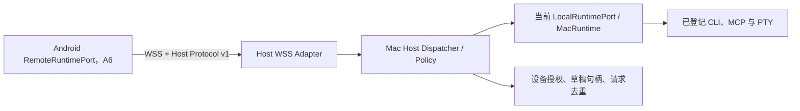

# A5：macOS Host 模块与配对协议设计

> 设计基线 v0.1，2026-11-13。A5 尚未实现；本文确定后续实现所遵循的接口、协议和安全要求。仍以 [Android 适配计划](android-adaptation-plan.md) 的阶段门槛为准。

## 目标与当前代码事实

Host 是同一 Flutter App 中由用户主动开启的 macOS 远程执行入口。它复用当前 App 已打开的 `MacRuntime`、Keychain、MCP 会话、CLI 和 PTY；不创建另一个运行时副本或后台 `launchd` 进程。App 退出或用户关闭 Host 后，手机显示 Host 离线。



现有实现给协议带来几项必须处理的约束：

- `LocalRuntimePort.createLive()` 创建一个 `MacRuntime`；Host 必须注入并复用此实例，不能自行重新打开同一份连接存储。
- `RuntimePort.invoke()` 接受调用方传入的 `permissionGranted`。Mac Host 不能把网络请求里的布尔值直接当作授权；先按配对设备、连接和 `PermissionLevel` 做 Host 本地策略检查，再决定是否可委托运行。
- `ConnectionSetupDraft.values` 只应存在于内存；`ConnectionSpec.toJson()` 不包含 `authToken`。Host 的传输 DTO 必须显式区分公开配置和凭证字段，日志、活动和错误中不得记录凭证值。
- `MacRuntime.testConnectionSetup()` 会执行草稿中的程序路径。Host 不得接受 Android 传来的任意绝对路径；新 CLI 必须先由 Mac 用户选择/登记，再用 Host 签发的短期 `executableRef` 表示。
- `CliCommand` 只含连接 ID 和参数列表；PTY 的可执行程序由已保存连接决定。协议不提供 `shell(command)`、`process.start(path, args)` 或任意工作目录 RPC。
- `watchRun()` 已提供带 `RunId` 和递增 sequence 的事件；`watchTerminal()` 目前只提供文本流，Host 适配器需补充可恢复的终端事件序号。

## 模块接口与接缝

新增深模块 `MacHostModule` 承担 Host 生命周期、身份、授权、草稿/运行归属和协议分发。App 只知道 Host 控制接口，不管理 socket、签名、重试、游标或 MacRuntime 的内部 ID：

```dart
abstract interface class HostControlPort {
  HostStatus get status;
  Stream<HostStatus> watchStatus();
  Future<void> start();
  Future<void> stop();
}
```

A5.1 先落地状态查询与 `start()` / `stop()`；邀请、设备批准和撤销操作会在 A5.4 配对身份模型确定后加入此接口。

实现使用两个接缝：

1. **运行端接缝：**注入 `RuntimePort`、`ConnectionSetupPort`、`ConnectionAccountPort`，生产接 `LocalRuntimePort`，测试使用 fake。Mac Host 通过统一 dispatcher 调用这些已存在的契约；不在 socket handler 中直接创建进程或访问路径。
2. **传输接缝：**注入 Host transport adapter，生产使用 `dart:io` secure WebSocket，测试使用内存消息适配器。Dispatcher 在传输之外执行设备授权、输入限制、敏感字段处理、请求去重及目标运行时调用。

Host 不实现第二套连接、CLI、MCP 或账号运行逻辑。网络层只接受本文逐项列出的已登记操作；未识别方法返回 `methodNotFound`。

## 传输与版本

- 使用 **WSS（TLS 1.2 或更高）+ JSON-RPC 2.0**。JSON-RPC 的 `id` 只用于请求/响应关联；Aggregate 的 `protocolVersion` 在 `host.hello` 中协商，当前主版本为 `1`。不同主版本不兼容时返回 `unsupportedVersion`，不能忽略未知字段后执行有副作用的请求。
- v1 客户端请求必须包含非空字符串 `id`；禁用 batch 和 client notifications。Host 可以用 JSON-RPC notification 向已认证连接推送事件。
- 文本帧用 JSON；批量 RPC 禁用，以便明确执行顺序、权限和失败点。媒体/文件不放进任意 base64 JSON；如 A5.2 实作需要传文件，使用版本化的分块数据帧和 Host 发放的一次性传输句柄。
- 每个改变 Mac 状态或可能产生外部副作用的操作都带 `operationId`。Host 将 `(deviceId, operationId, payloadHash, state)` 先记入 Mac 本地的权限受限操作账本再执行。`payloadHash` 是方法名与参数（排除 request ID、签名、时间戳和 `operationId`）的规范 JSON SHA-256。同一 ID、同一参数重发只返回已记录状态；同一 ID 不同参数返回 `idempotencyConflict`。`started` 后 Host 意外退出则保持 `outcomeUnknown`，不得把重试当成新操作执行。
- `RunEvent.sequence` 与 `TerminalEvent.sequence` 用作恢复游标。重连后客户端携带最后确认的 sequence；Host 只重放缺失事件。缓冲区已淘汰时返回 `cursorExpired`，手机需重新读取运行状态，不能自动重放调用。
- MCP 调用或配置操作断线时，客户端先查询 `operationId`/`RunId`。结果未知的调用不自动重试。终端文本、取消信号和账号登录命令不重放。

认证帧在内层放标准 JSON-RPC 文本；设备使用 Android Keystore 中的 P-256 私钥签名，算法固定为 ECDSA/SHA-256，签名以 DER 编码后 base64。签名输入按 UTF-8 精确构造为 `aggregate-host-v1\n{hostId}\n{deviceId}\n{timestamp}\n{nonce}\n{payloadSha256Hex}`；ID 和 nonce 字符集受限、不得包含换行。`payloadSha256Hex` 是接收的内层 JSON-RPC UTF-8 字节的 SHA-256，不由两端解析后重序列化再签名。示意：

```json
{"protocolVersion":1,"hostId":"host-…","deviceId":"device-…","timestamp":1794528000,"nonce":"…","payload":"{\"jsonrpc\":\"2.0\",\"id\":\"req-…\",\"method\":\"run.invoke\",\"params\":{\"operationId\":\"op-…\",\"capability\":{…},\"arguments\":{}}}","signature":"base64…"}
{"jsonrpc":"2.0","id":"req-…","result":{"run":{"id":{"value":"…"}}}}
{"jsonrpc":"2.0","method":"run.event","params":{"subscriptionId":"sub-…","sequence":3,"event":{"runId":{"value":"…"},"sequence":3,"state":"running","occurredAt":"…","blocks":[]}}}
```

第一帧是已签名的客户端请求，第二、三帧是通过固定 TLS 通道返回的 Host 响应和事件。Host 先验证签名，再解析 `payload`，随后拒绝过期时间戳（±60 秒）、5 分钟内重放的 nonce、未知设备或缺少 grant 的操作。TLS pin 使用扫描配对二维码时记录的 Host 叶证书 DER SHA-256。设备在 TLS pin 验证后还需签署 Host 新发的随机 challenge，认证完成前不返回连接目录、能力或路径信息。

## 允许的方法与路径语义

首版只发布当前配对设备被授权的操作。所有操作都以 ID 引用已存在的 Host 对象；不能用手机发送路径来选择 Host 文件或程序。

| 方法组 | v1 操作 | 主机约束 |
| --- | --- | --- |
| Host 元数据 | `host.hello`、`host.status` | 返回稳定 `hostId`、协议主版本、Host 名称和在线能力；不返回密钥或 Home 路径。 |
| 连接 | `connection.list`、`connection.refresh`、`connection.remove`、`connection.move` | 只操作 Host 连接；ID 在 Android 侧加 Host 来源前缀，Mac 持久化原始 ID。删除必须清理 Mac 自有凭证/profile。 |
| 向导 | `setup.adapters`、`setup.detectExecutable`、`setup.test`、`setup.save`、`setup.discard` | 返回 Host 适配器目录；草稿句柄由 Host 签发并绑定设备身份；适配器必须在 Host 白名单内。CLI 只接受 Host `executableRef`，不接受任意路径。 |
| 能力与结果 | `capability.search`、`run.invoke`、`run.subscribe`、`run.cancel`、`run.listRecent`、`activity.clear`、`resource.read`、`prompt.get` | 能力/运行必须属于已授权连接；`permissionGranted` 仅在 Host 自身权限策略允许后传给 `RuntimePort`。 |
| 动作清单 | `manifest.get`、`manifest.save`、`manifest.readContent`、`manifest.exportContent` | 连接必须是已授权 CLI；文件内容经显式内容传输或一次性 Host 文件句柄，绝不把 Mac 路径当 Android 本地路径。 |
| 账号 | `account.read`、`account.beginLogin`、`account.waitLogin`、`account.logout` | 仅暴露 Mac 已实现并验证的账号适配器；登录的 PTY/配置/profile 留在 Mac。登出需要对应设备授权和用户确认。 |
| 终端 | `terminal.open`、`terminal.subscribe`、`terminal.write`、`terminal.resize`、`terminal.interrupt`、`terminal.close` | 只对登记 CLI 连接开放；单独 `terminal` grant；宿主执行程序仍由连接决定。限制参数、帧、并发和输出缓存。 |

不远程暴露 Mac 全局 UI 偏好、任意 `previewLocalFile(path)`、`revealLocalFile(path)`、本机原始文件路径操作、未经批准的程序路径、任意环境变量、任意 shell 字符串或动态代码加载。若未来要增加方法，先新增版本化 DTO、授权规则、输出上限和恢复语义，再纳入允许列表。

### 向导密文与程序引用

- 公开字段通过版本化 `SetupDraftPayload` 传送；`authToken`、Private Key 等由独立 `secretValues` 段承载，只通过已经配对的 WSS 连接传输。调试日志只记录 request ID、adapter ID、字段名、字节数和结果状态，不记录值或原始 body。
- Mac Host 生成随机 `draftHandle`，并映射到 MacRuntime 的真实 `draftId`；映射键包含 `deviceId`，默认 TTL 10 分钟。保存/丢弃成功、输入变更、设备断线超时、Host 停止和撤销配对时失效；必要时调用 `discardConnectionSetup` 删除临时 profile。
- `executableRef` 和 `manifestRef` 是 Host 随机签发的 opaque 引用，绑定设备/草稿并短期有效。路径由 Mac 文件选择/登记流程确认后保留在 Mac；Android 只能显示明确标注的 Host 路径，不能传回该字符串执行文件操作。

## 配对、认证与授权

1. Host 只有在 Mac 用户主动开启时才创建 WSS listener。它生成稳定随机 `hostId`，TLS server key/certificate 由 macOS Keychain 保护；Listener 运行时才将必要密钥材料载入进程内存，停止时清理。默认不随登录后台启动。
2. Mac 展示一次性配对 QR 和待批准设备。QR 中包含 Host ID、发现信息、TLS 证书 SHA-256 指纹及 5 分钟有效、单次可用的邀请 nonce；不含长期设备凭证。Bonjour 仅用于发现在线地址，不代表信任。
3. Android 首次配对时在 Android Keystore 生成 P-256 请求签名密钥，发送公钥、随机 `deviceId` 和邀请 nonce。Mac 显示设备名称、平台及短确认码，由 Mac 用户批准后，按连接和权限等级发放最小 grant；默认只给读取，外部写入、终端、账号管理和连接管理需额外授权。
4. Android 对每个 RPC 请求签署规范化的 method、request ID、operation ID、时间戳、nonce 和 body SHA-256。Host 验证设备公钥、时间窗、nonce 未重放、请求大小和 grant，再进入 dispatcher。TLS 的 Host 身份以扫描时记录的证书指纹固定；不能对任意证书返回接受。
5. Mac 的“已配对设备”设置可撤销设备；撤销立即终止其 WebSocket、清理该设备草稿/一次性引用并关闭它拥有的终端。Host 证书轮换必须通过 Mac 用户确认后让设备重新配对，不能静默改 pin。

配对仅代表身份可信，不代表设备自动拥有所有功能。Host 按 `(deviceId, connectionId, grant)` 检查每次调用；grant 包括读取、调用权限等级、连接设置/管理、账号、终端、活动清理和内容传输。设备端 UI 的确认不替代 Host 授权。现有 `PermissionLevel` 的 `read`、`localControl`、`externalWrite` 应保留，不把未知权限降级为允许。

## 生命周期、网络权限与资源限制

- 只有 A5.4 的配对/认证入口完成后，生产传输才允许绑定 TLS listener。A5.1 的 `PairingRequiredHostTransport` 固定拒绝启动，不含 socket 或 Bonjour 操作；不能以测试 transport 的启动成功代表 Host 已可联网。后续生产 `start()` 先装载密钥/授权、绑定 TLS listener、注册 Bonjour，全部成功后状态才变为 `running`；邀请生成另由 A5.4 控制，不能因单纯开启 Host 就发放配对凭据。部分启动失败需回滚 socket 和服务发现。`stop()` 先拒绝新请求，关闭 listener 和所有远程订阅，再清理 Host 自有草稿、PTY 和运行；停止与本机 UI 的 LocalRuntime 分离，不能调用全局 `MacRuntime.dispose()`。
- 由于 MacRuntime 是 App 内进程对象，App 退出后 Host 离线。远程运行在网络断开后只可继续等待/查询；App 退出后的外部结果标为未知，不自动重放。
- Bonjour 服务类型固定为 `_aggregate-host._tcp`。Mac app 的 `Info.plist` 需提供 `NSLocalNetworkUsageDescription` 和 `NSBonjourServices`； macOS 15 首次本地网络访问会触发系统授权。应使用正式签名的 App 进程发起网络操作，Host 未运行时不触发本地网络访问。
- WSS 使用随机端口；只绑定当前可路由的局域网接口，不能绑定公网接口或打开端口转发。发现/配对不发送凭证。Server 必须检查 TLS 版本、Host 证书 pin、请求签名和时间窗；明文 WS 一律拒绝。
- Host v1 实作前定出并测试帧大小、字段长度、每设备并发、超时和事件缓冲限额。上限至少不宽于 MacRuntime 的 3 个并发运行/终端和每条 1 MiB 输出缓冲；传输不可把一个连接的无界数据写入另一连接。
- 错误只返回稳定错误码、阶段、短脱敏说明；不返回 Dart stack、命令 stderr 中的秘密、Home 路径或 Keychain 错误详情。运行的 stdout/stderr 仍通过用户已授权的结果/终端流可见，不进入 Host 诊断日志。

## 阶段落地顺序

| 子阶段 | 交付 | 关闭条件 |
| --- | --- | --- |
| A5.1 | `HostControlPort`、复用 MacRuntime 的 `MacHostModule`、显式 start/stop 生命周期；默认关闭。生产 listener 在 A5.4 配对认证完成前保持禁用。 | 不能创建第二个 MacRuntime；服务停止不破坏本机连接；启动/停止序列化，启动失败会回滚。 |
| A5.2 | JSON-RPC v1 的 DTO/方法目录、错误、事件游标、operationId、规范化哈希和协议兼容规则。 | 协议测试覆盖拒绝未知方法/版本、重复字段与无效 schema、请求/响应帧限制、重复写操作冲突和进程重启后的结果未知。 |
| A5.3 | Host adapter allowlist、executableRef、设备绑定 draftHandle、凭证传输与 Mac 端授权。 | 不接受任意路径/命令；秘密不落日志、Activity 或持久草稿。 |
| A5.4 | Keychain/Android Keystore 设备身份、一次性配对、最小 grant、撤销/重连/轮换。 | 未批准设备无法执行；撤销立即断开并清理关联资源。 |
| A5.5 | 真机普通 CLI、TUI、stdio/HTTP MCP、网易云向导以及未授权/越权/重复请求样本。 | 手机能在标注 Mac 执行的位置完成允许流程，Host 失败不改成本地执行。 |

## 依据与限制

- [Apple TN3179：本地网络隐私](https://developer.apple.com/documentation/technotes/tn3179-understanding-local-network-privacy) 与 [NSLocalNetworkUsageDescription](https://developer.apple.com/documentation/BundleResources/Information-Property-List/NSLocalNetworkUsageDescription) 说明本地单播/Bonjour 操作、macOS 本地网络许可、用途说明及 Bonjour 服务列表。Apple 还建议用正式代码签名身份确保 macOS 能可靠识别负责程序。
- [Dart `HttpServer.bindSecure`](https://api.dart.dev/dart-io/HttpServer/bindSecure.html) 支持 HTTPS listener 与指定接口绑定；[Dart `WebSocketTransformer`](https://api.dart.dev/dart-io/WebSocketTransformer-class.html) 支持从 HTTP(S) 升级至双向 WebSocket；[`HttpClient.badCertificateCallback`](https://api.dart.dev/dart-io/HttpClient/badCertificateCallback.html) 允许客户端作证书判断，必须仅在与已配对 Host 指纹相符时接受，不能全局关闭验证。
- [Android Keystore](https://developer.android.com/privacy-and-security/keystore) 可生成设备私钥并限制密钥用途；实际设备是否提供硬件保护需运行时检查，本设计不依赖 StrongBox。
- [JSON-RPC 2.0 Specification](https://www.jsonrpc.org/specification) 是请求/响应/错误格式基线；Host 另定义版本协商、签名、授权、流事件、幂等及超限规则。
- [RFC 8785：JSON Canonicalization Scheme](https://www.rfc-editor.org/rfc/rfc8785) 可用于计算稳定的 `payloadHash`；签名本身以外层封装中的精确 `payload` UTF-8 字节为对象，不依赖字段排序。

此文是接口与威胁边界设计，不是实现或安全审计结论。Dart listener 的 TLS 最低版本、macOS Keychain 身份装载、Mac 本地网络授权弹窗和 Android Keystore 签名必须在 A5 实际代码与设备上逐项验证。

## A5.2 实现状态（2026-11-13）

- `app/lib/platform/macos/host/host_rpc_protocol.dart` 提供 33 个封闭的 v1 方法定义、请求/事件 DTO 和稳定错误码。解析器拒绝未知字段、重复 JSON key、批量请求、客户端通知、不支持的协议主版本和超过 1 MiB 的请求帧；出站帧也通过同一字节上限检查。JSON 深度限制为 64。向导草稿和连接器清单仅接受 Host 签发的 opaque 引用，不接受 Mac 绝对路径。
- `app/lib/platform/macos/host/host_jcs.dart` 按 RFC 8785 对 method 与参数（去除 `operationId`）生成 SHA-256 操作哈希；外层设备签名仍按上文对收到的原始 payload 字节计算。
- `app/lib/platform/macos/host/host_operation_ledger.dart` 以 `(deviceId, operationId)` 隔离记录开始/完成/结果未知状态，不持久化请求参数、结果或秘密。启动时把遗留 `started` 记录改为 `outcomeUnknown`，绝不自动重放。账本上限为 10,000 条或 4 MiB，达到上限后拒绝新操作。
- `app/lib/platform/macos/host/host_setup_coordinator.dart` 是 A5.3 进行中的 Host 向导核心：只公开固定 adapter allowlist；仅返回绑定设备和 adapter 的随机 `executableRef`，不返回 Mac 路径；适配器字段决定公开值和秘密值的分离，secret map 单值不超过 32 KiB；`draftHandle` 绑定设备并在 10 分钟后失效。结果检查文本和保存连接摘要脱敏。Host stop 与设备撤销清理可安全丢弃的草稿；保存异常按结果未知处理，不重试也不删除可能已被连接引用的 profile。
- `app/lib/platform/macos/host/host_setup_rpc_dispatcher.dart` 增加 `operation.read`（协议目录现在为 34 个方法）和 setup RPC 分发。分发器要求调用方传入已认证会话的 deviceId，并注入 `HostRpcAuthorizationPort`；授权只接收脱离 `secretValues` 的参数。副作用前先写 operation ledger；相同 ID 重试返回记录状态，不重复执行；失败时明确写 `outcomeUnknown`，并可由 `operation.read` 查询状态。
- 验收只证明协议、账本、向导 coordinator 和 setup dispatcher 的本地单元行为；dispatcher 尚未接入 transport 的已认证会话、真实 grant store 或生产存储目录权限，生产 transport 仍拒绝启动。通用 CLI 的 Host 程序登记、manifest/content transfer 和真正的配对加密传输仍待实现与验收。不能据此宣称手机已能连接或 Host 端副作用已获得生产级授权。
