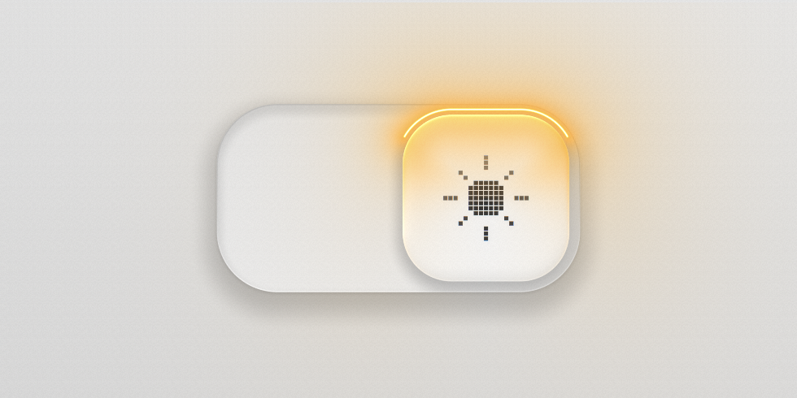
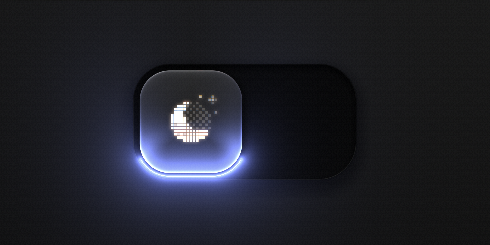

# Aggregate macOS 全功能 UI 设计稿 v3.1

> 日期：2026-11-19
> 状态：macOS 视觉实施基准；本阶段只提交设计稿和参考素材，不改产品页面代码。
> 画板：1360 × 900 SVG；示例数据均为设计占位，不表示实际连接、运行结果或设备状态。
> v3.1 修订：按首轮生产 Profile 对照，将窗口应用名和交通灯位置改为 macOS 原生左对齐几何；原生标题栏浅深外观跟随应用偏好。

## 1. 这份设计稿如何用于实施

这份稿子把完整桌面功能放进同一套视觉系统，并把每一页对应到现有 Flutter 页面。后续实现以画板的页面结构、层级、留白和控件位置为目标；页面行为则以当前生产代码和 UI-0 冻结清单为准。

实施和验收都在 Aggregate 的 Flutter 页面上完成。最终截图必须来自 `AggregateApp` / `PreviewRuntime` 的 macOS Profile 窗口。SVG 是可量尺寸的目标稿，不是最终产品截图，也不用于代替生产控件。逐页对照时把窗口逻辑尺寸设为 1360 × 900；同一页先比标题、分栏、区域边界和主操作位置，再比表面、点阵、光效和文字层级。结构偏差超过约 8 logical px 或主次操作落在不同区域时，该页仍需调整。窄窗则按 §4 的断点另行验收。

此稿仅重新组织视觉呈现。连接协议、Runtime、MusicSession、账号接口、权限边界、确认条件、快捷键、数据保留规则和结果状态均沿用现有实现。

### 主题切换控件的固定视觉基准

设计稿里的设置页使用一张明确标注的生产控件局部截图，目的是锁定用户认可的玻璃、点阵和光效质感。截图不是切换控件的产品实现。正式页面继续直接放置 `GlassThemeSwitch` 实例，背景透出同一张 `GlassScene`，截图框与示意底板不会进入成品。

浅色参考：



深色参考：



控件的实时任意拖动、进度映射、阈值、提交时机、回调、太阳/月亮内部点阵变化、光效和动画节奏全部冻结。截图仅作为静态外观证据。实现时保留生产控件与现有 shader / calibration；不重画太阳月亮、不做帧序列回放、不改尺寸以外的手势逻辑。

## 2. 全局视觉规格

### 设计方向

| 角色 | 画板参考值 | 使用边界 |
| --- | --- | --- |
| 雾面天空 | `#EEEEF2` | 浅色全窗场景；生产取共享 `GlassScene` |
| 玻璃高光 | `#FFFFFF` | 按钮上缘与局部反光，不铺成整页底色 |
| 云灰阴影 | `#D9D9DF` | 场景转暗和内凹层级 |
| 墨色文字 | `#292932` | 标题与主要文字 |
| 蜜金焦点 | `#EFAD49` | 当前任务、主要操作和选择边缘 |
| 状态绿 | `#39765D` | 与状态文字一起出现的连接/成功提示 |

这些值用于 SVG 画板示意。产品颜色仍由 `GlassDesignTokens` 和 `GlassScene` 提供，深色版沿用同一语义角色，不复用这些浅色字面值。

- 字体：macOS 系统无衬线字体，中文回退到 PingFang SC；页面标题 25pt，区块标题 17pt，正文 12–14pt，辅助信息 10–12pt。数字和状态仍用同一字族，避免把元数据做成第二套视觉语言。
- 对齐：页面标题与内容统一左对齐；播放器当前歌曲居中在播放器卡片里；运行/搜索等主操作靠近其表单或参数区；危险操作远离主要操作。
- 页面骨架：导航宽度取生产 macOS 外壳的 224pt；SVG 的 16pt 画板边距计入后，主内容从 x≈270pt 开始。

```text
窗口
┌─ 224pt 导航 ─┬──────────── 页面标题 / 工具栏 ─────────────┐
│ 连接          │                                           │
│ 页面          │   当前任务内容                            │
└───────────────┴───────────────────────────────────────────┘

宽工作区 / 连接详情
┌─ 可滚动目录 约 34% ─┬─ 当前详情、参数、操作与结果 ───────┐
│ 当前连接或能力      │ 从说明到执行，再到结果              │
└─────────────────────┴───────────────────────────────────┘
```

主视觉只留给用户认可的太阳/月亮玻璃控件和当前主要操作。普通区域使用连续背景、细分隔和少量内凹输入面；不把每项内容都切成同尺寸卡片。功能本身决定按钮图案，点阵颗粒、边缘高光和光线方向保持同一材质语言。动态效果只反馈悬停、焦点、按下或真实忙碌状态。

### 窗口和布局

- 画板外框采用约 16pt 的窗体留白与 18pt 圆角；原生标题栏高约 42pt。
- 应用名沿用 macOS 原生窗口标题的左对齐位置；窗口原生外观跟随应用的系统/浅色/深色偏好，避免 Flutter 场景与原生标题栏一明一暗。
- 左侧连接导航的目标内容宽度约 224pt，分隔线细且低对比。导航依次展示我的连接、所有功能、管理连接、活动和置底设置；连接状态点只显示 Runtime 的真实状态。
- 内容左右留白约 30–34pt。页面标题、说明和本页主操作先组成稳定标题区；内容区再按任务拆列或分组。
- 宽度 ≥ 760pt 时目录与详情并排；低于 760pt 时先目录后详情，保持原路由和页面状态。可见音乐迷你播放器占用窗口底部独立区域并横跨导航与主区；`Scaffold` 为它预留高度，页面内容不被覆盖。
- 主要工作区不铺不透明的大底板。输入、终端、结果、弹窗和选中目标才用局部玻璃表面或内凹面。

### 背景、色彩和玻璃

- macOS 全窗背景统一走 `GlassScene`；外观设置、侧栏、详情和浮层共享场景坐标，不为主题控件或主页面另加不透明背景。
- 文字、分隔线、输入面、状态色沿用 `GlassDesignTokens` 的明暗语义。实际颜色仍从生产 token / shader 读取，禁止按 SVG 颜色重新造一套产品色值。
- 玻璃使用细亮边、柔和内外阴影和低幅度反光。橙色只指出当前主动作或选择；绿色、琥珀色、红色同时配文字表达状态，不单靠颜色传义。
- 按钮和图标沿用同一 9×9 点阵语汇。圆点直径、间距和软边一致；不同动作保留不同轮廓与语义，不把图案糊成线图标。
- 点阵按生产目录的真实掩码绘制：导航图案 16pt，列表行图案 22pt，文字按钮图案 22–24pt，独立图标按钮图案 24pt。运行、刷新、搜索、暂停、前后曲、停止与收藏都保留各自轮廓；不能把不同动作统一替换成播放三角或通用齿轮。

### 按钮和动效

| 状态 | 视觉目标 | 行为边界 |
| --- | --- | --- |
| 静置 | 低幅呼吸或微弱边缘流光，注意力留给文字和任务内容 | 动效不代表请求已完成，不自动触发回调 |
| Hover / Focus | 局部边缘更清晰；键盘焦点有可见光环 | AX 名称、命中范围和键盘访问保持 |
| 按下 | 玻璃面轻微下压，点阵收束后回弹；文字仍清楚 | 回调仍在原有一次点击时机执行 |
| Selected | 细暖边与略高表面层级 | 不改变当前选择逻辑 |
| Busy / Disabled | 图形静止或降低动态幅度；尺寸不变；显示真实状态 | 忙碌、取消与禁用继续由业务状态控制 |
| Reduce Motion | 静置装饰停下，状态变化保留即时反馈 | 遵循系统减少动态效果设置 |

新按钮的目标可从 90–130ms 的按下收束、180–240ms 的回弹、约 220ms 的选中变化开始校准；最终以 UI-6 Mac Profile 实测和原生逐项签收为准。按钮图案仍通过现有点阵目录与共享绘制器实现。主题切换不套用这组按钮时序。

各动作继续使用[UI-3 动效规范](../stage-3-coordinated-motion.md)中已经建立的一对一 `GlassGlyph` → `GlassMotionAction` → profile 映射，不做“所有按钮同一圈光”的通用动效。主要图案方向如下：

| 操作图案 | 静置细节 | 点击细节 |
| --- | --- | --- |
| 运行 / 播放 | 三角内部轻微前向流光 | 点阵前推、核心亮度升高后归位 |
| 暂停 | 左右两列交替微亮 | 两列同步制动并稳定 |
| 上一首 / 下一首 | 箭头按各自方向轻移 | 朝对应方向短促滑移后回弹 |
| 刷新 | 沿弧线缓慢游光，圆弧轮廓保持清楚 | 完整顺向旋转并归位 |
| 搜索 | 镜心弱扫描，镜柄保持稳定 | 镜片轻聚焦并扫过中心 |
| 复制 / 粘贴 | 两层点阵保留细微错位 | 两层分离再贴合，或沿输入方向吸附 |
| 添加 / 保存 | 中央十字微呼吸；保存底缘微流光 | 十字聚合后舒展；保存图案轻落到基线 |
| 停止 / 取消 | 图案低频明暗，禁用时静止 | 点阵收拢制动，不旋转、不伪造完成 |
| 连接 / 权限 | 节点依次微亮，护盾边缘柔和透光 | 节点吸附或护盾聚合，范围仍可辨 |
| 删除 / 撤销配对 | 危险色只在相关动作附近低亮显示 | 图案下沉收束；二次确认继续由原弹窗承担 |

这些是相位和动作方向约束，不重新发明已有点击回调或 profile 数值。UI-6 仍需用原生 Profile 实窗确认各生产按钮实例的实际节奏和清晰度。

## 3. 全功能画板目录

点击编号打开可缩放 SVG。每张画板均使用同一个 1360 × 900 窗口、导航外壳、背景和按钮语言；具体示例数据只服务视觉检查。

| 画板 | 页面或状态 | 生产页面 / 关键组件 |
| --- | --- | --- |
| [01 工作台与能力运行](01-workspace.svg) | 搜索、筛选、能力目录、参数和结果并排 | `WorkspacePage`、`CapabilityRunPage`、`SchemaForm`、`ResultPanel` |
| [02 音乐首页](02-music.svg) | 当前曲目、播控、搜索结果与条件式队列控制 | `MusicPlayerPage`、`MusicSession`、`MusicSearchResults` |
| [03 连接管理](03-connections.svg) | 连接列表、状态、诊断、刷新、动作编辑和危险操作 | `ConnectionsPage` |
| [04 活动记录](04-activity.svg) | 状态筛选、元数据详情、重开/查看、取消与诊断 | `ActivityPage` |
| [05 外观设置](05-settings-appearance.svg) | 当前模式、原控件基准图、单独的系统跟随选项 | `SettingsPage`、`AppearanceSelector`、`GlassThemeSwitch` |
| [06 Mac Host](06-settings-host.svg) | Host 状态、邀请、待处理配对、已配对设备 | `MacHostSettingsPanel` |
| [07 添加连接](07-connection-setup.svg) | CLI / MCP 类型、配置、执行目标、连接测试 | `ConnectionSetupDialog` |
| [08 运行中的终端](08-terminal-running.svg) | 运行状态、取消、真实终端会话和流式输出 | `CapabilityRunPage`、`TerminalPage` |
| [09 执行前授权](09-permission-confirmation.svg) | 连接、动作、参数、执行端和确认操作 | `CapabilityRunPage` |
| [10 通用状态](10-states.svg) | 加载、空连接、无搜索结果、失败、待确认、拒绝 | `PageState`、各页面 Runtime 状态分支 |
| [11 按钮状态与动效](11-button-motion.svg) | 点阵静置、按下、选中、忙碌、禁用和 Reduce Motion | `AggregateActionButton`、`GlassActionButton`、`GlassGlyphCatalog`、`GlassMotion` |
| [12 深色工作台](12-dark-reference.svg) | 深色层级、输入面、选中项和文字对比 | `AggregateTheme`、`GlassScene`、`GlassDesignTokens` |
| [13 动作编辑器](13-action-editor.svg) | 原始 JSON 清单、动作预览、参数检查和保存 | `ActionEditorDialog` |
| [14 音乐扫码登录](14-music-account-login.svg) | 未登录、二维码占位、扫码等待、取消和失败提示 | `MusicAccountControl`、账号对话框 |
| [15 快捷键与本机数据](15-settings-shortcuts-data.svg) | 快捷键、保留时间、清空活动入口 | `SettingsPage`、`ShortcutScheme` |
| [16 成功结果](16-result-success.svg) | 结构化结果、复制、重开和再次运行 | `ResultPanel`、`CapabilityRunPage` |
| [17 CLI 连接首页](17-connection-home.svg) | 当前连接能力目录、无参数动作、运行与最近结果 | `ConnectionHomePage`、嵌入式 `CapabilityRunPage` |
| [18 音乐迷你播放器](18-mini-player.svg) | 曲目摘要、条件式播放控制、打开与收起 | `MusicMiniPlayer`、`MusicSession` |
| [19 执行目标选择](19-target-selector.svg) | 本机与可用 Host 目标、选择或取消 | `showConnectionSetupTargetDialog` |
| [20 Host 权限编辑](20-host-permissions.svg) | Host scope 和逐连接读取 / 控制 / 写入权限 | `_HostGrantDialog` |
| [21 MCP 连接首页](21-mcp-home.svg) | 工具、资源、提示分组，以及对应的详情/参数/结果 | `ConnectionHomePage`、嵌入式 `CapabilityRunPage` |

普通 CLI 连接首页使用 17；MCP 首页使用 21。二者由 `experienceFor` 返回的连接类型确定页面结构。v3 的预览样例来自 `PreviewRuntime`：Git CLI 有 1 项功能，HTTP MCP 有 3 项功能，音乐连接有 8 项功能；MCP 分组分别为 1 个工具、1 个资源、1 个提示。音乐账号对话框仅在 Runtime 提供 `ConnectionAccountPort` 时显示。示例二维码不可扫描，Host、连接、播放和活动数据均为画板样例。

## 4. 页面信息结构和交互顺序

### 应用外壳与导航

入口在 [01 工作台与能力运行](01-workspace.svg)、[02 音乐首页](02-music.svg) 和 [03 连接管理](03-connections.svg)。当前选中连接留在连接导航组；全局 `⌘K` 在任意页进入工作台并聚焦搜索。工作台自身显示唯一搜索框，其他页面使用工具栏入口。连接加号贴近连接组，连接添加成功后的选择行为不变。

### 功能目录、连接首页和执行

- [01 工作台](01-workspace.svg)：顶部搜索与类型筛选固定，左侧能力目录滚动，右侧详情、参数、运行按钮和结果依次排列。首屏画出 12 项中的前 8 项，剩余项目通过目录滚动查看。收藏是独立操作，不与打开能力共用点击目标。
- [17 CLI 首页](17-connection-home.svg) 和 [21 MCP 首页](21-mcp-home.svg)：只展示当前连接的能力；宽窗左目录、右详情，目录项可直接内嵌运行。MCP 目录分为工具、资源、提示，资源展示读取内容，提示先形成参数表单。窄窗使用“目录 → 详情/参数 → 结果”的顺序。
- 连接首页目录在 1360pt 画板中约 260pt（约占主内容四分之一）；工作台目录约占 34%。连接目录需容纳工具/动作名称和分组，工作台目录优先给参数与结果留出空间。
- [08 运行终端](08-terminal-running.svg) 和 [16 成功结果](16-result-success.svg)：终端保留真实会话、输入、滚动和中断。结果按实际返回类型决定复制、文件预览、访达访问和再次运行操作。
- [09 执行授权](09-permission-confirmation.svg)：明确来源、执行目标、操作和输入；用户确认前不开始执行。权限拒绝、失败、取消、超时和结果未知沿用各自状态与原恢复入口。

### 音乐

- [02 音乐首页](02-music.svg)：宽屏按现有 4:6 列布局呈现播放器和搜索；播放器使用当前音乐图标、曲名、歌手、状态详情及控件。上一首/下一首在连接提供对应动作时显示；若队列当前位置没有目标曲目则禁用。界面不浏览队列明细。入队按钮仅在连接提供 `music.queueAdd` 时出现。账号入口仅在 Runtime 实现可选 `ConnectionAccountPort` 时出现。
- [14 扫码登录](14-music-account-login.svg)：扫码登录在音乐连接账号面板中完成，账号由连接端确认。保留刷新、退出、切换/登录、取消扫码和错误恢复。不要把登录入口挪到普通 CLI、MCP 或终端。
- [18 迷你播放器](18-mini-player.svg)：仅有可见会话时显示在应用底部；它用音乐图标和两行歌曲/会话摘要，没有封面图或进度拖杆。上一首/下一首只有在连接提供对应动作且队列存在目标曲目时出现；播放/暂停、停止、刷新状态、打开播放器和收起保留现有条件。所有内容来自同一个 `MusicSession`。切页不重建会话；输入法打开或无可见会话时按当前逻辑隐藏。

### 连接、执行目标和 Host

- [03 连接管理](03-connections.svg)：左侧列表负责选择和排序，右侧显示身份、运行状态、配置、检查结果和常用动作；删除继续使用原确认流程。
- [19 执行目标](19-target-selector.svg)：在类型与配置之前选择设备。选项名称、可用性和权限说明必须来自 `ConnectionSetupTargetPort`；画板只示范布局，不能写死设备名或伪造在线状态。
- [07 添加连接](07-connection-setup.svg)：类型、执行目标、字段配置、连接测试按向导顺序推进。CLI、MCP stdio 和 MCP HTTP 使用各自字段；上一步、取消、程序路径选择、认证和保存条件不变。
- [06 Mac Host](06-settings-host.svg)：运行状态、邀请与设备授权放同一连续设置内容区。邀请有效期、等待批准、配对结果和已配对状态从 Host 提供。
- [20 Host 权限](20-host-permissions.svg)：全局 Host scope 与逐连接权限分开显示。必需读取权限、权限组合约束、不可用能力保留、没有逐连接授权时不可保存等条件保持现状。撤销和身份轮换仍走原高风险确认流程。
- [13 动作编辑器](13-action-editor.svg)：保持原始 JSON 清单编辑，不拆成另一套表单。参数检查仅预览最终参数数组，不执行程序；导入、导出、保存、取消和校验错误都留在当前编辑上下文。

### 活动与设置

- [04 活动](04-activity.svg)：筛选器只按运行状态过滤。列表与详情显示能力、来源、发生时间、状态和运行 ID；活动本身不保存参数或结果正文。活动记录可查看运行/重开能力、取消仍可取消的运行、复制诊断；不增加连接/时间筛选或重新执行按钮。
- [05 外观](05-settings-appearance.svg)：标题区读出当前模式；生产页面保留一个原生实时切换控件，并把“跟随 macOS 系统”作为单独按钮。画板中的截图框只用于锁定参考质感，不复制到产品页面。
- [15 快捷键与本机数据](15-settings-shortcuts-data.svg)：快捷键沿用 `ShortcutScheme`；保留时长使用原选项，清空操作保持危险区与确认。
- [10 通用状态](10-states.svg)：加载、无连接、无匹配、连接错误、结果未知和权限拒绝共享排版规则，但标题、说明和操作必须对应业务的真实状态，不能依靠按钮动画暗示成功。

## 5. 设计数据和真实性边界

画板内的连接名称、音乐内容、数值、路径、活动时间、状态、Host 设备和权限组合都是静态示例。实施截图可用 `PreviewRuntime` 的预览内容复现视觉，但结果必须标记为预览数据。真实 Mac Host、权限、连接地址和账号状态只由生产 Runtime 提供；装饰动画不改变业务状态。

唯一真实控件外观素材为 `theme-switch-light.png` 和 `theme-switch-dark.png`，来自本轮以前的 macOS 生产页面截图裁切。两张图片只作为设计档案。生产页面必须调用 `GlassThemeSwitch`，不得把这两张图片打包进 App。

## 6. 页面到源码的对应关系

| 设计区域 | 生产代码入口 |
| --- | --- |
| 外壳、导航、快捷键、迷你播放器位置 | `app/lib/app/app_shell.dart`、`app/lib/app/shortcut_scheme.dart` |
| 全窗背景和明暗 token | `app/lib/widgets/glass/glass_scene.dart`、`app/lib/widgets/glass/glass_design_tokens.dart`、`app/lib/app/theme.dart` |
| 主题切换与外观设置 | `app/lib/features/settings/settings_page.dart`、`app/lib/features/settings/appearance_selector.dart`、`app/lib/features/settings/glass_theme_switch.dart` |
| 工作台和参数运行 | `app/lib/features/catalog/workspace_page.dart`、`app/lib/features/invocation/capability_run_page.dart`、`app/lib/features/invocation/schema_form.dart`、`app/lib/widgets/result_panel.dart` |
| 连接首页、设置向导、目标选择、动作编辑 | `app/lib/features/connections/connection_home_page.dart`、`app/lib/features/connections/connections_page.dart`、`app/lib/features/connections/connection_setup_dialog.dart`、`app/lib/features/connections/connection_setup_target_dialog.dart`、`app/lib/features/connections/action_editor_dialog.dart` |
| 运行终端与活动 | `app/lib/features/invocation/terminal_page.dart`、`app/lib/features/activity/activity_page.dart` |
| 音乐播放器、搜索、账号和跨页会话 | `app/lib/features/music/music_player_page.dart`、`app/lib/features/music/music_search_results.dart`、`app/lib/features/music/music_account_control.dart`、`app/lib/features/music/music_mini_player.dart`、`app/lib/features/music/music_session.dart` |
| Mac Host 与设备权限 | `app/lib/platform/macos/mac_host_settings_panel.dart`、`app/lib/platform/macos/host/` |
| 统一点阵按钮和光效 | `app/lib/widgets/glass/aggregate_buttons.dart`、`app/lib/widgets/glass/glass_action_button.dart`、`app/lib/widgets/glass/glass_glyph.dart`、`app/lib/widgets/glass/glass_motion.dart`、`app/lib/widgets/glass/glass_optic_renderer.dart` |

## 7. 实施顺序与每阶段验收

设计文件由 [render_design_draft.py](render_design_draft.py) 生成。页面编码分组实施；每组必须完成代码、实际交互复核、Profile 截图对照、阶段记录、独立提交和远端核对后，才进入下一组。

1. **工作台与普通连接首页**：对照 01、08、09、10、16、17、21；验收搜索、目录/详情、参数校验、权限确认、终端、结果未知及窄窗退化。Git 与 MCP 首页的示例项目分别按 PreviewRuntime 的 1 项/3 项能力核对。
2. **音乐整页与迷你播放器**：对照 02、14、18；验收播放会话跨页保持、前后曲可用条件、可选 `queueAdd`、搜索确认、可选账号端未登录/已登录/失败、扫码取消及减少动态效果。不得出现未提供的队列明细或进度拖杆。
3. **连接管理和配置向导**：对照 03、07、13、19；验收 CLI / MCP 不同字段、设备目标、路径选择、测试失败保留表单、动作 JSON 检查和危险操作。
4. **活动、设置与 Host**：对照 04、05、06、15、20；验收活动筛选和详情、设置偏好、Host 配对、逐连接权限、权限确认和数据清理。
5. **整体精修和原生验收**：对照 11、12 与全部页面；检查明暗主题、焦点、AX 标签、静置/点击动画、窗口缩放、性能和原主题拖动逻辑。

每阶段比较同一窗口尺寸下的生产 Profile 截图和 SVG。必须匹配页面结构、列宽、主要操作位置、控件尺寸、间距、材质层级及按钮图案；字体抗锯齿差异不作为布局偏差。发现页面与稿不符时，先确认是稿子错、实现错还是当前 Runtime 数据不同，更新基准和记录后再签收。完成实施不会自动代表用户视觉确认；尚未实窗验证的项继续标待验收。

## 8. 设计阶段自验记录

- Python 生成器语法检查通过；成功生成 21 张 SVG 画板。导航轨按生产 macOS 224pt 侧栏校准；画板 16pt 窗口内边距之后主内容从约 x=270pt 起排。
- 21 张画板均由 macOS SVG 渲染器转为 1360 × 900 PNG 并抽查；音乐主页面按播放器/搜索 4:6 分栏复核，活动状态筛选、无队列列表的迷你播放器、实际 PreviewRuntime 的 CLI/MCP 能力数与示例动作均已交叉核对。
- `theme-switch-light.png` 与 `theme-switch-dark.png` 可单独查看，浅色太阳和深色月亮均保留生产控件截图中的内部点阵与光效。
- 本阶段未修改产品源码，未把设计样例数据写入 Runtime。
- 产品代码匹配这些画板、页面交互及双主题 Profile 实测属于后续实施验收，不计入此设计阶段通过范围。
