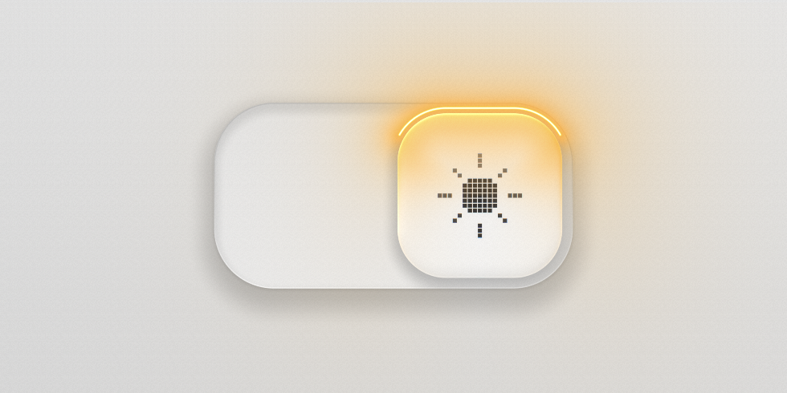
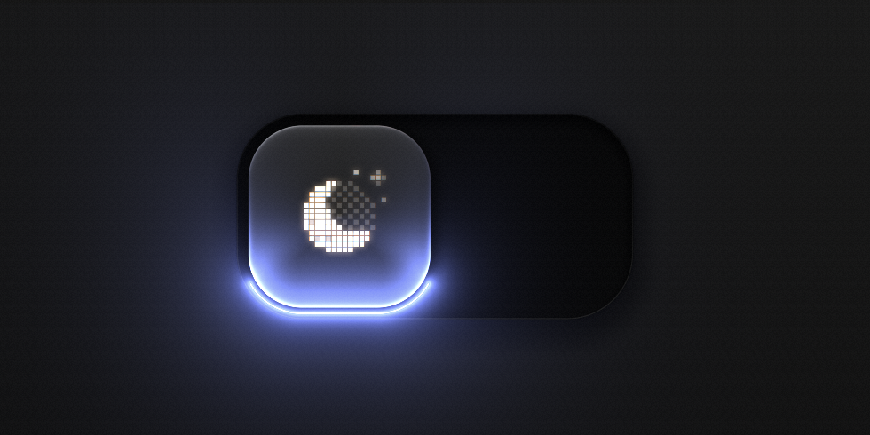

# Aggregate macOS 全功能界面设计稿 v4.0

> 状态：本轮全应用视觉与交互基准。设计先于页面实现；最终外观以同一套生产 Flutter Widget 在隔离 macOS Profile 中的画面为准。
> 平台：macOS。共享 Flutter/Dart 契约继续保持平台无关。
> 功能基线：现有 `AggregateApp`、`RuntimePort`、`MusicSession`、Host 权限与 UI-0 行为冻结清单。

## 1. 设计目标

Aggregate 是连接 CLI、MCP、本机音乐和 Mac Host 的工作台。界面要让用户快速找到连接、理解当前状态、完成一次操作并判断结果。视觉以用户认可的太阳/月亮玻璃开关为材质母体：同一片天空背景、柔润的玻璃体积、圆润点阵图案和有方向的局部光线。主操作应像开关一样容易辨认和触达；列表、表单和信息区为操作提供清晰上下文。

本稿覆盖所有现有 macOS 页面和状态，不新增 Runtime 能力。原太阳/月亮开关的状态机、连续拖动、方向反转、阈值、回调、太阳/月亮内部变化、光效和时序全部冻结；页面可调整控件框尺寸和位置。

固定材质参考仍是生产控件本身：

## 2. 唯一视觉来源

过去的 22 张 SVG 画板保留为功能、文案、状态和信息顺序索引。它们不再作为最终材质、字体、按钮比例或动画的逐像素基准。SVG 不会运行生产 shader，也不使用 Flutter/macOS 字体回退；按 SVG 重画玻璃会再次造成“稿像一套、软件像另一套”。

设计预览与产品必须使用同一生产 Flutter Widget 树：

1. 使用 `AggregateApp`、`AppShell`、生产页面和生产玻璃组件。
2. 只注入 `Ui6InspectionRuntime`、`Ui6InspectionHost` 等进程内样例；不调用外部服务、不读 Keychain、不写入用户连接、不执行真实 CLI/MCP。
3. 先在该预览中完成视觉探索和页面排布，再将确认的同一 Widget 布局接入真实 Runtime。不要另建 HTML/CSS 或手绘的“最终预览”。
4. 每阶段保存浅色、深色及关键交互截图；屏幕截图是设计版本的可见表达。结构 SVG 用来核对功能遗漏，不以它代替 Profile 画面。

当前隔离入口为 [UI 检查预览](../../app/lib/preview/ui6_inspection_main.dart)，运行时为 [Ui6InspectionRuntime](../../app/lib/preview/ui6_inspection_runtime.dart)。正式实施时将入口/标记升级为 UI-7 设计预览，但继续复用相同生产 Widget 与内存 stub。

## 3. 视觉系统

### 3.1 画面性格

**软光学玻璃工作台**：连续、安静的天空背景作为画布，玻璃按钮提供可触的层级，内容按工作顺序排布。记忆点只放在控件材质和当前主要操作上；不要让每个分区都变成相同的大卡片，也不要靠大标题、粗描边或成排金色发光制造层级。

| 层 | 视觉任务 | 落地规则 |
|---|---|---|
| 连续场景 | 让导航、内容和外观控件处在同一空间 | 继续使用全窗 `GlassScene`；不叠不透明大底板，不在子页面重新起一张背景 |
| 玻璃操作 | 清楚表达可点击、选中、按下和忙碌 | 复用 `GlassActionButton` 光学层；边缘圆润、厚度柔和，阴影靠近本体，点阵图案留有呼吸空间 |
| 内容表面 | 承载输入、终端、结果和弹窗 | 只在需要分组或编辑时使用内凹/浅玻璃面；避免所有内容都套卡片 |
| 信息文字 | 让状态、描述和字段可快速扫读 | macOS 系统字体，左对齐；状态文字与图形同时表达，不单靠颜色 |
| 焦点光 | 指向当前选择和最重要操作 | 暖金只在主操作、焦点、选中和相应动效中出现；非活跃控件保留中性玻璃质感 |

### 3.2 颜色与字体

界面使用 `GlassDesignTokens` 与 `AggregateTheme` 的语义色，不在页面另写一套近似 hex。当前浅色/深色的表面、文字、玻璃上/下缘、高光、焦点、状态与危险色是实现取值；调色必须在生产预览截图中复核，不能只看 token 色块。

| 角色 | 浅色语义 | 深色语义 | 使用方式 |
|---|---|---|---|
| 场景/表面 | `surface` / `raised` | `surface` / `raised` | 页面连续透出场景；局部表面区分编辑与结果 |
| 主文字 | `text` | `text` | 页面标题、按钮名、字段值 |
| 次级文字 | `muted` | `muted` | 解释、时间、辅助标签；仍需清楚可读 |
| 边缘/分隔 | `line` | `line` | 只分隔信息组，不围住每个控件 |
| 暖光/焦点 | `warm` / `glow` / `focusRing` | 同语义深色值 | 主操作、选中、焦点和交互反馈 |
| 状态/危险 | `status` / `danger` | 同语义深色值 | 与“就绪/失败/删除”等文字和图案配对 |

使用 macOS 系统无衬线字体及系统中文回退；字号层级以生产 `TextTheme` 为准。标题、正文、辅助字之间拉开层级，不把日期、状态和 ID 全部加粗。任何截图中小字如果缩放后难读，应提高字号或缩短文案，不用更浅的灰来弱化。

### 3.3 布局骨架

- 标准对照窗为 1360 × 900 logical px。侧栏宽 240pt，主内容起点约 x=299pt；导航连接项和主导航项宽度保持一致。
- 页面内容优先左对齐。标题、说明和本页主操作构成一组；工具栏控件靠近其作用的内容。
- 工作台、连接首页、连接管理、活动使用“目录/列表 → 详情/参数 → 结果”的阅读顺序。左右分栏只在足够宽时出现；窄窗改为逐层进入，不挤压表单。
- 页面正文不全宽铺卡。字段名与字段值形成稳定列，长 ID 与路径可复制并允许截断/展开。
- 固定迷你播放器为全窗底部独立层；页面滚动区预留高度，不遮住最后一项或焦点。
- 主要动作靠近对应表单/结果；危险动作独立分组并沿用原二次确认。

## 4. 按钮系统

所有可点击控件共享太阳/月亮开关的玻璃做法和 9×9 圆点阵图案，但根据任务采用不同外形、面积、光效和动作。点阵轮廓不要求每个图案一样；材质、颗粒尺度、圆角、光线方向和按压响应必须统一。

| 按钮类型 | 使用位置 | 静置态 | 点击态与语义 |
|---|---|---|---|
| 主操作 | 运行、保存、确认当前步骤 | 玻璃体积更完整，暖光集中在一侧，内部主动作图案轻微呼吸 | 光能向图案汇聚并回弹；不延迟、不重复调用回调 |
| 次操作 | 刷新、复制、导入、预览 | 中性玻璃，高光更克制；各自图案有低幅度、错相静置动作 | 刷新旋转、复制点阵收拢、导入向内展开等语义动作 |
| 导航/列表 | 连接、页面、功能和活动项 | 未选中时保留轻薄表面；选中态形成柔和边缘高光和标记 | 选择反馈在本体内完成，不改变行高、不推动相邻内容 |
| 图标动作 | 加号、返回、更多、收起 | 独立小型玻璃体，图案居中，命中区至少 40×40pt | 光斑与点阵短促响应；保留可读 VoiceOver 名称 |
| 分段筛选 | 活动状态、类型筛选 | 组内共享背景，选中项用局部暖光与点阵状态区分 | 切换不重排页面、不清除其他业务状态 |
| 危险操作 | 删除、撤销配对、身份轮换 | 中性本体与低饱和危险边缘，不持续闪烁 | 仍先进入现有确认；取消不会触发危险回调 |

### 动效约束

- 每种动作有自己的点阵姿态和光效，但由 `GlassMotion` 共享时钟驱动；不为每颗粒或每个按钮各建定时器。
- 静置动画细小、错开相位，不让全屏按钮同时呼吸；悬停/键盘焦点提高当前控件的可见度；按下反馈短而清楚。动画幅度不能造成布局位移、改变尺寸或遮盖文字。
- 忙碌、成功、失败、取消、超时、结果待确认由业务状态提供。动画只表达状态变化，不宣告业务成功。
- Reduce Motion 开启时保留静态形态和操作反馈，停用连续装饰运动。
- 禁用态降低光效并保留状态语义；不能只靠降低透明度造成看不清。

## 5. 全功能页面设计清单

下表定义每页用户任务、主次信息和必须出现的状态。链接到 v3.8 的 SVG 是功能与内容索引；实际玻璃/字体/布局由同阶段的 Flutter Profile 页面截图定版。

| 页面/画板 | 用户任务与信息顺序 | 主操作和必须覆盖的状态 | 生产入口 |
|---|---|---|---|
| 工作台与能力运行 [01](design-draft-v3/01-workspace.svg) | 搜索 → 类型筛选 → 能力列表 → 详情/参数 → 结果 | 收藏、打开、表单校验、权限确认、运行中、取消、成功/失败/待确认 | `WorkspacePage`、`CapabilityRunPage`、`SchemaForm` |
| 普通 CLI 首页 [17](design-draft-v3/17-connection-home.svg) | 当前连接 → 能力目录 → 动作详情 → 参数/结果 | 打开、运行、最近结果、空/错误状态 | `ConnectionHomePage` |
| MCP 首页 [21](design-draft-v3/21-mcp-home.svg) | 工具/资源/提示分组 → 选中项详情 → 参数或读取内容 | 调用工具、读取资源、填提示；加载/失败/空状态 | `ConnectionHomePage` |
| 音乐首页 [02](design-draft-v3/02-music.svg) | 当前曲目/会话 → 播控 → 搜索结果 | 播放/暂停/停止；前后曲与入队只在能力可用时显示 | `MusicPlayerPage`、`MusicSession` |
| 音乐账号 [14](design-draft-v3/14-music-account-login.svg) | 账号状态 → 扫码/登录 → 等待或错误 | 登录、刷新、退出、取消；连接未提供账号能力时不显示入口 | `MusicAccountControl` |
| 迷你播放器 [18](design-draft-v3/18-mini-player.svg) | 曲目摘要 → 播放状态 → 常用操作 | 播控、打开播放器、收起；复用同一 `MusicSession` | `MusicMiniPlayer` |
| 连接管理 [03](design-draft-v3/03-connections.svg) | 连接目录 → 状态/诊断 → 能力 → 管理操作 | 添加、测试、动作编辑、移动顺序、删除确认；就绪/连接中/不可用 | `ConnectionsPage` |
| 添加连接 [07](design-draft-v3/07-connection-setup.svg) | 执行目标 → 类型 → 类型字段 → 测试 → 保存 | CLI、MCP stdio、MCP HTTP；路径选择、校验、测试失败保留输入 | `ConnectionSetupDialog` |
| 执行目标选择 [19](design-draft-v3/19-target-selector.svg) | 本机与可用 Host 目标 → 权限/可用说明 | 选择或取消；数据来自 `ConnectionSetupTargetPort` | `showConnectionSetupTargetDialog` |
| 动作编辑 [13](design-draft-v3/13-action-editor.svg) | JSON 清单 → 参数预览 → 检查结果 → 保存 | 新增/导入/导出、校验错误、取消；预览不执行程序 | `ActionEditorDialog` |
| 运行终端 [08](design-draft-v3/08-terminal-running.svg) | 当前命令/连接 → 流式输出 → 运行状态 | 输入、取消、中断；遵循实际会话生命周期 | `TerminalPage` |
| 执行授权 [09](design-draft-v3/09-permission-confirmation.svg) | 来源 → 目标 → 动作 → 输入摘要 → 确认 | 确认/拒绝；确认前不得执行 | `CapabilityRunPage` |
| 成功结果 [16](design-draft-v3/16-result-success.svg) | 结果摘要 → 结构化内容 → 可用操作 | 复制、文件预览、Finder、重开/再次运行按结果类型出现 | `ResultPanel` |
| 通用状态 [10](design-draft-v3/10-states.svg) | 状态标题 → 原因 → 下一步 | 加载、空、无匹配、失败、取消、超时、拒绝、结果未知 | `PageState` 与 Runtime 状态分支 |
| 活动 [04](design-draft-v3/04-activity.svg) | 状态筛选 → 记录列表 → 元数据详情 | 查看/重开、可取消时取消、复制诊断；不展示参数和结果正文 | `ActivityPage` |
| 外观设置 [05](design-draft-v3/05-settings-appearance.svg) | 当前主题 → 系统/浅/深偏好 → 实时开关 | 保留原开关手势与回调；共享背景，不加预览底板 | `SettingsPage`、`GlassThemeSwitch` |
| Mac Host [06](design-draft-v3/06-settings-host.svg) | Host 状态 → 邀请 → 待配对 → 已配对 | 启停、轮换、复制、批准/拒绝；值来自 Host 控制端口 | `MacHostSettingsPanel` |
| Host 权限 [20](design-draft-v3/20-host-permissions.svg) | 全局范围 → 每连接权限 → 保存/撤销 | 读/控/写组合和确认规则沿用原逻辑 | `_HostGrantDialog` |
| 快捷键 [15](design-draft-v3/15-settings-shortcuts.svg) | 功能名称 → 对应组合键 | 沿用 `ShortcutScheme` | `SettingsPage` |
| 本机数据 [22](design-draft-v3/22-settings-local-data.svg) | 保存范围 → 保留期限 → 清理 | 原时长选项、清空确认和本机说明 | `SettingsPage` |
| 深色主题 [12](design-draft-v3/12-dark-reference.svg) | 在上述各页检查暗色层级 | 文字、焦点、玻璃边缘、状态与按钮明暗均需独立检查 | `AggregateTheme`、`GlassScene` |
| 按钮状态 [11](design-draft-v3/11-button-motion.svg) | 每类点阵按钮的 idle/hover/focus/pressed/selected/busy/disabled | 静置与点击动画、减少动态效果、键盘和辅助功能名称 | `AggregateActionButton`、`GlassActionButton`、`GlassMotion` |

### 核心用户流程

1. **找到并运行功能**：全局搜索或工作台筛选 → 选中功能 → 检查参数 → 看清连接与执行端 → 权限确认 → 运行 → 阅读结果/恢复提示。
2. **添加连接**：添加 → 选执行目标 → 选择连接类型 → 填写该类型配置 → 测试 → 保存；测试失败时保留输入。
3. **管理连接**：选择连接 → 看真实状态/诊断 → 打开能力或调整动作顺序 → 必要时测试 → 危险删除走原确认。
4. **听音乐**：搜索 → 选择结果 → 同一 MusicSession 更新完整页和迷你播放器；账号、队列和前后曲按钮只在 Runtime 能力存在时出现。
5. **授权 Mac Host**：启动 Host → 生成/复制邀请 → 查看待配对 → 确认范围 → 通过/拒绝 → 后续编辑或撤销权限继续走现有确认。
6. **检查历史**：按状态过滤 → 选择记录 → 查看元数据和诊断 → 只在状态允许时取消，或重开原功能；不自动重放调用。

## 6. 稿件到实现的验收门槛

每个阶段先核对本稿中的任务、内容顺序和状态，再在隔离 Profile 中调整生产 Flutter 页面。页面达到可复核视觉后，保存对应截图并固定窗口、主题、缩放、样例数据与滚动位置；该截图即为阶段视觉基准。真实 Runtime 只替换数据和动作来源，不另写一套布局。

每页逐项检查：

- 页面任务是否一眼可见，主要操作是否位于其对应内容旁边。
- 文案、按钮顺序、字段和状态与功能基线一致；没有虚构的按钮、设备、权限或成功结果。
- 所有按钮来自同一玻璃材质和点阵语言；主次层级清楚，静置/悬停/焦点/按下/忙碌/禁用态都能辨认。
- 浅色、深色、Reduce Motion、键盘焦点和 VoiceOver 名称各自核对；不能用一个主题的截图推断另一主题。
- Profile 预览只使用内存 fixture；不得让验收操作执行真实 CLI/MCP、写偏好、改用户连接或读敏感凭据。
- 用户已授权逐阶段自行验收、提交并推送；未实测的项目记录为待验收，不把布局测试或 SVG 检查升级成视觉通过。

## 7. 修订原因

v3.8 覆盖了全部 22 个页面，但它自述 SVG 只锁结构与坐标；这不足以约束玻璃材质、按钮比例和视觉重心。前一轮按 SVG 继续微调活动/连接时，静态稿和 Profile 画面已出现可见差异。v4.0 因此把“生产 Flutter Profile 截图 + 同一 Widget 树”确立为唯一视觉源，把静态 SVG 限定为功能和状态索引；不再通过在生产页面外另做 HTML 或 SVG 材质模拟来给出预览。
